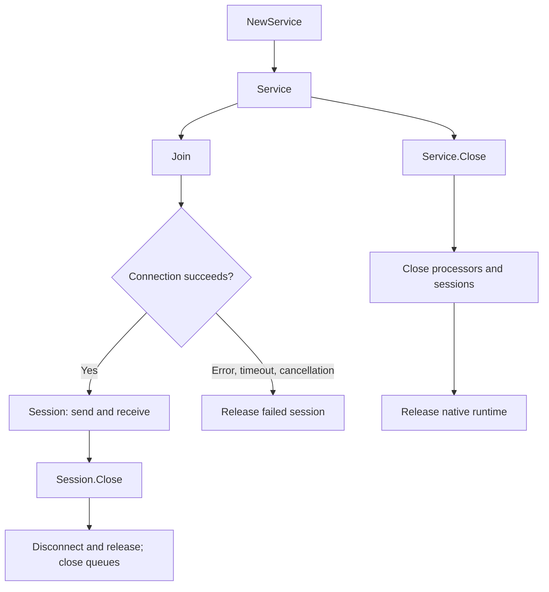

# RTC reference

[简体中文](rtc.zh-CN.md) · [Home](../README.md) · [Examples](../examples/README.md)

This guide describes the root `agorasdk` package. Defaults and validation below are wrapper contracts; acceptance by the native SDK, project permissions, and interoperability are separate requirements. See [sources and version scope](#sources-and-version-scope).

## Lifecycle and ownership

Only one high-level `Service` may be open in a process; a second returns `ErrServiceActive`. Create independent sessions with `Service.Join` for each channel/identity. Each session owns its connection, tracks, observers, and six receive queues. An `AudioProcessor` belongs to its service and does not need a channel.

- `Join(ctx, cfg)` waits for connection success, failure, cancellation, or `JoinTimeout`. Failure releases the incomplete session. Canceling the context **after a successful join does not close the session**.
- `Session.Close` disconnects, releases native resources, closes `Done()`, and closes receive queues. `Done()` signals explicit session closure, not each network disconnection. Read `Info()` for a copied connection snapshot and `Events()` for network changes.
- `Service.Close` closes its processors and sessions before releasing the runtime. Service, session, and processor `Close` methods are idempotent; inspect returned errors.
- Session methods support concurrent callers by serializing native access. Application-level ordering is your responsibility: use one producer per media track; concurrent `PlayPCM` calls interleave audio. Do not mutate an input buffer while a method is using it.
- Cancel read/playback contexts and let producer goroutines finish before closing the service. Contexts cannot interrupt a blocking reader or synchronous native call. Do not mix raw `rtc.Initialize` / `rtc.Release` with a live `Service`.

## Configuration and validation

### Service configuration

| `Config` field | Default / contract |
| --- | --- |
| `AppID` | Required; wrapper checks exactly 32 bytes and no NUL |
| `Video` | `false`; set `true` before any raw/encoded video sending or reception |
| `AudioProcessing` | `false`; set `true` before creating external audio processors |
| `LogPath`, `ConfigDir`, `DataDir` | Empty; delegated to native defaults; set controlled paths in production |
| `ConfigureNative` | Optional initialization callback; `UseStringUid` must remain `true`, `IdleMode` must remain `false` |

### Channel configuration

| `ChannelConfig` field | Default / wrapper validation |
| --- | --- |
| `Channel`, `UserID` | Required, not whitespace-only, no NUL; at most 64 / 255 bytes respectively |
| `Token`, `Info` | Empty allowed; no NUL; `Info` is an optional native connection payload |
| `Role`, `Mode` | `Broadcaster`, `Standard`; native profile is live broadcasting |
| `Audio.Mode` | `PCM`; alternatives: `EncodedAudio`, `NoAudio` |
| `Audio.SampleRate`, `Audio.Channels` | 16000 Hz, 1; valid PCM rates: 8000, 16000, 32000, 44100, 48000 Hz; 1 or 2 channels |
| `Audio.Scenario`, `Audio.Profile` | `ScenarioAuto` maps to native AI-server scenario; zero `Profile` is passed through |
| `Audio.VAD`, `Audio.VADConfig` | `false`, `nil`; VAD requires 16000 Hz mono; non-nil settings are validated and copied |
| `Video.Mode` | `NoVideo`; alternatives: `RawVideo`, `EncodedVideo` |
| `Video.Encoder`, `Video.EncodedSender` | `nil`; native encoder/sender settings can be supplied |
| `Receive.Disabled` | `false`; `true` skips PCM observation and automatic audio subscription; it does not disable every receive interface |
| `Receive.ManualSubscriptions` | `false`; required for `LargeScale` |
| `Receive.AudioPositions` | Zero selects `AudioBeforeMixing`; valid bitmask is 1–31 |
| `Receive.Video`, `Receive.EncodedAudio`, `Receive.EncodedVideo` | All `false`; opt in independently |
| `QueueCapacity` | 64 per stream; valid range 1–65536 |
| `JoinTimeout` | 30 seconds; zero selects default; negative rejected |
| `Encryption` | `nil`; otherwise configured before connect; peers need compatible native encryption settings |
| `ConfigureNative` | Optional pre-allocation connection/publishing callback |

The older Chinese Go `Connect` reference documents **64-byte** IDs; the pinned headers define a 256-byte account-length constant, and this wrapper accepts up to 255 bytes. These are different version-scoped contracts. Prefer IDs within 64 bytes of the documented ASCII set for cross-version compatibility; do not interpret the older limit as a verified native 4.6 hard ceiling. Use the same string-user-ID scheme for all participants, with distinct IDs in one channel. `NoAudio` disables audio publication, not reception; `Audience` disables media publication.

## PCM audio

Use signed, interleaved PCM16 little-endian without a WAV/container header. One 10 ms frame is `SampleRate / 100 * Channels * 2` bytes: 320 bytes at the default 16 kHz mono.

| Operation | Contract |
| --- | --- |
| `SendPCM(data)` | Nonempty, whole 10 ms frames; may send several frames per call; no pacing or resampling |
| `SendPCMAt(data, timestamp)` | Same validation; presentation timestamp in milliseconds |
| `PlayPCM(ctx, reader)` | Uses one 10 ms buffer and schedules sends at 10 ms intervals; reader must return promptly |
| `PlayPCMAt(ctx, reader, timestamp)` | Same pacing; nonzero initial presentation timestamp increases by 10 ms per frame; zero remains zero |
| `WaitPCM(ctx)` | Polls the Go binding’s sent-byte/wall-clock estimate every 10 ms, including its 180 ms margin; PCM mode only; not native queue or remote playback feedback |
| `InterruptAudio()` | Requests native sender interruption; does not cancel an active `PlayPCM` loop |
| `PublishAudio()` / `UnpublishAudio()` | Explicit track control; first send automatically publishes, including after unpublish |

`PlayPCM` pads the final short frame with silence, but rejects an incomplete interleaved sample (`len % (2 * Channels) != 0`). Its pacing is a software schedule, not a hard realtime guarantee. To stop playback, cancel its context; coordinate the producer before calling `InterruptAudio`, or later sends can refill the native queue. Keep audio and video timestamps in the same timebase.

### Receive audio and VAD

Read `session.Audio().Next(ctx)`. `AudioFrame.Data` and `Speech` are independent copies and may be retained. Inspect the frame’s actual `SampleRate`, `Channels`, `Position`, and timestamps. VAD yields activity state and speech audio, not recognized text.

| Observation point | Value | Meaning |
| --- | --- | --- |
| `AudioPlayback` | 1 | Playback audio |
| `AudioRecord` | 2 | Recording audio |
| `AudioMixed` | 4 | Mixed recording/playback audio |
| `AudioBeforeMixing` | 8 | Per-user remote audio; supplies `UserID` and VAD fields |
| `AudioEarMonitoring` | 16 | Ear-monitoring audio |

Combine positions with `|`. Availability depends on the active native media path; non-before-mixing callbacks do not supply an individual `UserID` in this wrapper. Received-audio VAD requires `Audio.VAD: true`, 16 kHz mono, enabled PCM reception, and `AudioBeforeMixing` among the positions. It does not require an external APM processor.

VAD v2 is implemented in the Go binding, using SDK-provided `VoiceProb` and `Rms`. With `VADConfig: nil`, its active defaults are:

| Setting | Default |
| --- | --- |
| `PreStartRecognizeCount` | 16 frames |
| `StartRecognizeCount` / `StopRecognizeCount` | 30 / 65 frames, each 10 ms |
| `StartRms` | −70 dB; converted to the binding’s 0–127 scale |
| `EnableAdaptiveRmsThreshold` | `true` |
| `AdaptiveRmsThresholdFactor` | 0.67 |

A non-nil zero-valued configuration is not equivalent to `nil`: only selected fields are normalized. The high-level validator accepts counts 0–10000, probabilities/factors 0–1, voice thresholds 0–100, and RMS thresholds −127–0 dB. The current decision path uses `VoiceProb == 1` or RMS above its adaptive/fallback threshold, plus consecutive active/inactive frame counts. Legacy `ActivePercent`, `InactivePercent`, `StartVoiceProb`, `StopVoiceProb`, and `StopRms` fields are accepted but do not control that path. See [`audio_vad2.go`](../agora/rtc/audio_vad2.go) before tuning.

## Encoded audio

Set `Audio.Mode: agorasdk.EncodedAudio`, then call `SendEncodedAudio` with one nonempty codec packet and accurate format/timing fields. `Opus` and AAC-LC (`AAC`) have high-level constants. The validator also accepts native PCMA, PCMU, G722, HE-AAC, JC1, HE-AAC2, LPCNET, and OpusMC values cast to `AudioCodec`; acceptance is not a promise that the installed SDK can send/decode them.

Encoded frame sample rates accepted by the wrapper are 7350, 8000, 11025, 12000, 16000, 22050, 24000, 32000, 44100, 48000, 64000, 88200, and 96000 Hz, with 1 or 2 channels. `SamplesPerChannel` must be nonnegative; supply the codec-correct value. These fields describe the packet, not a conversion request. This API neither demuxes a container nor paces packets. Enable `Receive.EncodedAudio` and consume `EncodedAudio().Next(ctx)` for reception; subscription is still required.

## Video

Enable `Config.Video` before creating the service. Sending and reception are independent. Raw video uses `Video.Mode: RawVideo`; encoded video uses `EncodedVideo`. Enable `Receive.Video` or `Receive.EncodedVideo` for the corresponding receive queue.

| Input / operation | Wrapper contract |
| --- | --- |
| All sent frames | Width/height 1–16384; rotation 0, 90, 180, or 270 degrees |
| `VideoFrame` I420 / NV12 | Tightly packed CPU bytes; even dimensions; exactly `width * height * 3 / 2` bytes |
| `VideoFrame` RGBA / BGRA | Tightly packed CPU bytes; exactly `width * height * 4` bytes |
| Optional `VideoFrame.Alpha` | Empty or exactly `width * height` bytes |
| `EncodedVideoFrame` | Nonempty H.264/H.265 frame; FPS 0–240; SEI at most 1024 bytes; supply codec, key-frame flag, dimensions, and timestamps |
| `SetVideoEncoder` | Width/height 1–16384; framerate 1–240; remaining constraints are native |
| `RequestKeyFrame(userID)` | Requests a remote key frame; does not synchronously return one |
| `SetSimulcast` | Passes native simulcast configuration; verify native distribution and peer support |
| `PublishVideo()` / `UnpublishVideo()` | Explicit control; the next send automatically republishes |

The numeric ranges above are validation bounds, not supported encoding resolutions or rates. Pace video at the source. A complete MP4 file or arbitrary file chunk is not an encoded frame; preserve access-unit boundaries. Received raw video owns separate Y/U/V planes with independent strides; do not assume tightly packed output. Received encoded data, SEI, metadata, and alpha are copied. Codec/platform support must be verified on the pinned distribution. Accepting pre-encoded H.265 does not imply native H.265 encoding: the pinned upstream version lists H.265 as decode-only.

## Subscriptions

Audio subscribes automatically unless `Receive.Disabled` or `Receive.ManualSubscriptions` is set. Video subscribes automatically only when a video receive flag is enabled and manual subscription is off. With manual subscription, call `SubscribeAudio(userID)` / `SubscribeVideo(userID, options)` after joining and when relevant `UserJoined` events arrive. A receive observer alone does not subscribe to a remote track.

`VideoSubscription{LowQuality: true}` requests the low-quality stream; `EncodedOnly: true` requests encoded-only delivery. The publisher must provide the requested stream. Use corresponding `Unsubscribe*` methods to stop subscriptions. `LargeScale` requires manual subscriptions and rejects `SubscribeAllAudio` / `SubscribeAllVideo` with `ErrUnsupported`; subscribe to individual IDs.

## Events, authentication, and data messages

### Events and tokens

Consume `Events().Next(ctx)` independently of media reads. Event families include connection/user changes, publication/subscription, media state, errors, statistics, volume, metadata, key-frame requests, and capability fallback. `SetVolumeIndication` accepts an interval from 0 to one hour and smoothing 0–10; it forwards whole milliseconds, and native timing semantics still apply.

On `TokenExpiring` or `TokenExpired`, request a fresh RTC token from your trusted server and call `RenewToken`. Match App ID, channel, **string user account**, and required role/privileges. The wrapper does not fetch or automatically refresh tokens. `CapabilityFallback` reports the native suggestion in `Reason`; the wrapper does not accept it automatically. The application can select a supported `AudioScenario` with `SetAudioScenario` outside the callback path. The pinned upstream AI-server path expects compatible AI-client peers; validate both ends or explicitly select a compatible fallback scenario.

`token.RTC` is an optional pure-Go AccessToken2 helper for trusted servers. Its `token.Config` defaults to `Publisher` and a one-hour lifetime; accepted lifetime is 1 second–24 hours, truncated to whole seconds. App ID and Certificate must each be 32 hexadecimal characters. It uses string accounts and does not generate RTM tokens. Never embed an App Certificate in clients, examples, or logs.

### RTC data and audio metadata

`SendMessage` sends 1–1024 bytes through the session’s native RTC data stream; consume `Messages().Next(ctx)`. The stream is **unordered and unreliable**. The native live-broadcasting transport permits sending only as a broadcaster and documents limits of 30 packets/second/channel, 6 KB/second/client, 1 KB/message, and at most 5 data streams/user/channel. The wrapper uses its internally created stream and checks only payload length; it does not rate-limit for you. A successful send is local acceptance, not receiver delivery. Use [RTM](../messaging/README.md) for its distinct messaging features.

`SendAudioMetadata` validates 1–1024 bytes locally, but the pinned upstream Chinese release notes document a **64-byte** payload limit. Keep payloads within 64 bytes unless the target native version is separately verified; 1024 is not a guaranteed native allowance. Incoming audio metadata arrives as an `AudioMetadata` event with copied `[]byte` data. Audio metadata and encoded-video SEI are different media paths; their availability follows native publishing and codec requirements.

## Queues and data lifetime

Each of `Audio`, `Video`, `EncodedAudio`, `EncodedVideo`, `Messages`, and `Events` has an independent bounded queue. Capacity defaults to 64 **items**, not bytes or milliseconds. When full, the oldest item is discarded so native callbacks do not wait for application consumers. `Stats()` reports a snapshot of `Capacity`, `Buffered`, `Dropped`, and `Closed`. Unconsumed enabled streams, including events, can overflow.

With a live context, `Next(ctx)` drains buffered items after closure, then returns `io.EOF`. An already canceled context returns its context error instead. Multiple readers compete for items; use application fan-out when every consumer needs a copy. Native memory is never exposed by high-level receive values, but concurrent mutation of the same Go value still requires application synchronization. [RTM uses a different overflow and closure contract](../messaging/README.md#events-and-queue-behavior).

## External processing and optional decoding

Create a processor with `Service.NewAudioProcessor` after enabling `Config.AudioProcessing`. `ProcessorConfig` defaults to 16000 Hz, 1 channel, and a 64-item output queue; PCM formats and queue bounds match RTC. `APM: nil` uses `rtc.NewAPMConfig()`; custom APM must provide all four component configurations. Send complete 10 ms PCM frames with `processor.SendPCM` and consume copied output with `processor.Output().Next(ctx)`. Close the processor explicitly or let its service close it.

Requested APM extensions must exist in the native package. The pinned Linux archive lacks the AINS extension; the default processor may fail native initialization. Do not advertise it as portable AI noise suppression. Validate each requested processor configuration on the target platform.

`Session.TranscodeVideo` and `Session.TranscodeOpus` asynchronously **decode and publish** through optional FFmpeg workers. Default builds return `ErrUnsupported`; enable `-tags avcodec` and install [development dependencies](development.md#optional-ffmpeg).

| Method | Requirement and output |
| --- | --- |
| `TranscodeVideo` | `RawVideo` publication; H.264/H.265 8-bit 4:2:0 Annex-B input; decoded raw-video output |
| `TranscodeOpus` | `PCM` publication; nonempty Opus packet, 1 or 2 input channels; output is always 48 kHz mono, independent of `ChannelConfig.Audio` |

Success means input was accepted into the worker path, not that decoding or sending succeeded. Later decode/send failures are not propagated through the original method result. Video sends the latest decoded frame on a timer, so frames may be skipped or repeated; it does not preserve arbitrary source timestamps. Close stops workers without guaranteeing pending input is published. Avoid mixing helper output with another producer on the same track. The `send_media` example instead uses the FFmpeg executable at runtime.

## Advanced configuration

`Config.ConfigureNative` runs before process initialization; `ChannelConfig.ConfigureNative` runs before connection allocation. Keep callbacks short and do not retain their pointers. Hooks can change native behavior beyond the defaults above; preserve the high-level ownership and mode assumptions.

`session.WithNative(func(*rtc.RtcConnection) error)` holds the session’s operation lock. Do not reenter Session methods, release or retain borrowed objects, or replace owned observers. Raw `agora/rtc` operations return native codes and do not gain wrapper validation or request-completion guarantees. `SetParameters` accepts a JSON object; use only documented native keys for the pinned version.

## Errors and troubleshooting

| Result | Meaning / action |
| --- | --- |
| `ErrInvalidConfig` | Wrapper rejected arguments; inspect the wrapped field description |
| `ErrServiceActive` | Another high-level Service owns the process runtime |
| `ErrNotPublishing` | Role or configured media mode does not permit this send |
| `ErrUnsupported` | Unsupported wrapper operation, mode, or optional build feature |
| `ErrClosed` | Operation on a closed service, session, or processor |
| `context.Canceled` / `context.DeadlineExceeded` | Join/read/playback wait ended; follow the operation-specific lifecycle rules |
| `io.EOF` | Closed RTC receive queue has been drained |
| `*agorasdk.Error` | SDK/binding or join failure; interpret numeric `Code` together with `Op` |

Use `errors.Is` for sentinel/context errors and `errors.As` for native errors. Native sends are submission results; track asynchronous failures through `Events`. For silent reception, check role, matching project/channel/identity, publish state, subscription flags, enabled observers, and queue drops. Inspect SDK logs without logging tokens or certificates.

## Sources and version scope

The wrapper behavior is defined by [`config.go`](../config.go), [`service.go`](../service.go), [`session.go`](../session.go), and the corresponding audio/video/stream implementations. Bindings are based on [Agora Go SDK v2.6.5](https://github.com/AgoraIO-Extensions/Agora-Golang-Server-SDK/tree/v2.6.5); native archives are pinned in [`sdk_versions.sh`](../scripts/sdk_versions.sh).

Version-scoped upstream details: [v2.6.5 Chinese README](https://github.com/AgoraIO-Extensions/Agora-Golang-Server-SDK/blob/v2.6.5/README.zh.md) covers platform restrictions, codecs, AI scenarios, large-scale subscriptions, and audio metadata. [RTC connection C++ API](https://doc.shengwang.cn/api-ref/rtc-server-sdk/cpp/classagora_1_1rtc_1_1_i_rtc_connection) and the pinned `NGIAgoraRtcConnection.h` define data-stream limits.

Official Chinese references: [Go API overview](https://doc.shengwang.cn/api-ref/rtc-server-sdk/go/go-api/overview), [RTC connection and identity constraints](https://doc.shengwang.cn/api-ref/rtc-server-sdk/go/go-api/rtcconnection). The public Go reference is labeled v2.2.4, so it explains native semantics but is not an exact API inventory for the vendored v2.6.5 bindings. For discrepancies, check the pinned headers and library on the target platform; never treat a newer online page as proof that this binary supports a feature.
