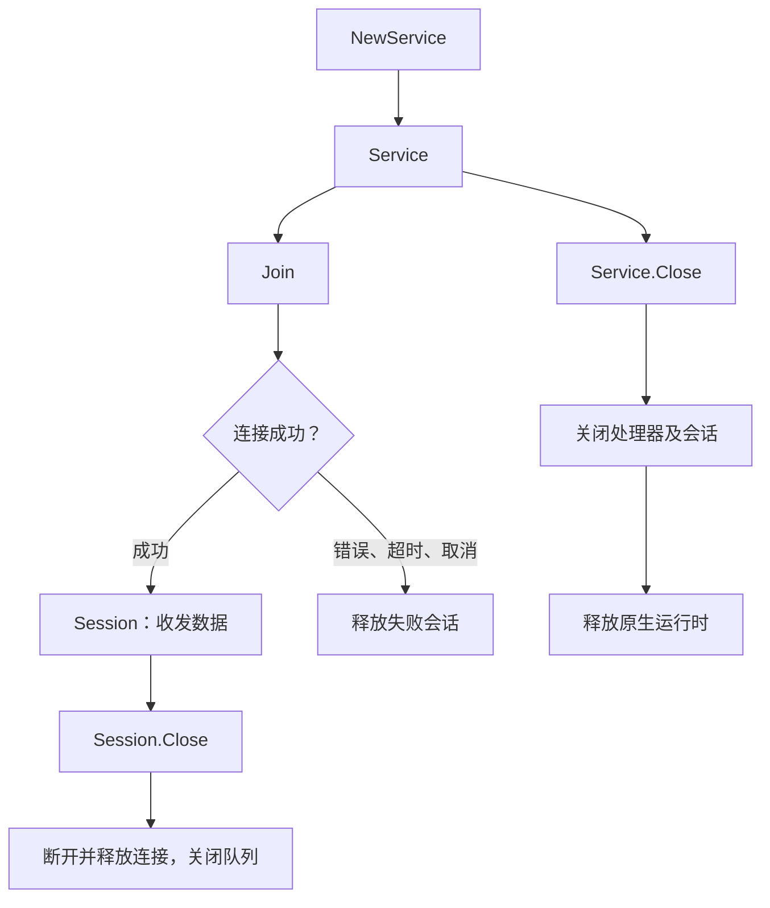

# RTC 使用指南

[English](rtc.md) · [首页](../README.zh-CN.md) · [示例](../examples/README.zh-CN.md)

本文说明根包 `agorasdk`。下述默认值和校验属于封装层约定；原生 SDK 支持、项目权限及端到端互通仍需分别确认。参见[资料与版本范围](#资料与版本范围)。

## 生命周期与资源归属

每个进程最多持有一个未关闭的高层 `Service`；重复创建返回 `ErrServiceActive`。不同频道或身份分别调用 `Service.Join`。Session 管理自己的连接、轨道、观察者及六个接收队列。`AudioProcessor` 由 Service 管理，无需加入频道。

- `Join(ctx, cfg)` 等待连接成功、失败、取消或 `JoinTimeout`。失败时释放未完成的会话。**入会成功后取消该 context，不会关闭会话**。
- `Session.Close` 断开并释放连接，关闭 `Done()` 和接收队列。`Done()` 表示显式关闭，不表示每次网络断开。`Info()` 返回连接快照；网络变化通过 `Events()` 交付。
- `Service.Close` 先关闭处理器和会话，再释放原生运行时。Service、Session 和处理器的 `Close` 均可重复调用；应检查返回错误。
- Session 方法支持并发调用，原生访问串行执行。业务顺序需自行保证：每条媒体轨道使用一个发送者；并发 `PlayPCM` 会交错音频。方法使用输入缓冲区期间，不要修改它。
- 关闭 Service 前，先取消读取和播放 context，再等待发送协程退出。context 无法中断阻塞的 reader 或同步原生调用。`Service` 存活期间，不要混用底层 `rtc.Initialize` / `rtc.Release`。

## 配置与校验

### Service 配置

| `Config` 字段 | 默认值与约束 |
| --- | --- |
| `AppID` | 必填；封装检查长度为 32 字节且不含 NUL |
| `Video` | `false`；收发原始或编码视频前须设为 `true` |
| `AudioProcessing` | `false`；创建外部音频处理器前须设为 `true` |
| `LogPath`、`ConfigDir`、`DataDir` | 空值使用原生默认值；生产环境应指定受控路径 |
| `ConfigureNative` | 可选初始化回调；`UseStringUid` 必须保持 `true`，`IdleMode` 必须保持 `false` |

### 频道配置

| `ChannelConfig` 字段 | 默认值与封装校验 |
| --- | --- |
| `Channel`、`UserID` | 必填，不能全为空白，不含 NUL；分别最多 64 / 255 字节 |
| `Token`、`Info` | 可为空，不含 NUL；`Info` 为可选原生连接信息 |
| `Role`、`Mode` | `Broadcaster`、`Standard`；原生频道配置为直播模式 |
| `Audio.Mode` | `PCM`；可选 `EncodedAudio`、`NoAudio` |
| `Audio.SampleRate`、`Audio.Channels` | 16000 Hz、1；PCM 支持 8000、16000、32000、44100、48000 Hz，1 或 2 声道 |
| `Audio.Scenario`、`Audio.Profile` | `ScenarioAuto` 映射为原生 AI-server 场景；`Profile` 零值直接传入原生层 |
| `Audio.VAD`、`Audio.VADConfig` | `false`、`nil`；VAD 要求 16000 Hz 单声道；非空配置会校验并复制 |
| `Video.Mode` | `NoVideo`；可选 `RawVideo`、`EncodedVideo` |
| `Video.Encoder`、`Video.EncodedSender` | `nil`；可传入原生编码器和发送器配置 |
| `Receive.Disabled` | `false`；`true` 跳过 PCM 观察和音频自动订阅，并非关闭全部接收接口 |
| `Receive.ManualSubscriptions` | `false`；`LargeScale` 必须启用 |
| `Receive.AudioPositions` | 零值选择 `AudioBeforeMixing`；有效位掩码为 1–31 |
| `Receive.Video`、`Receive.EncodedAudio`、`Receive.EncodedVideo` | 均为 `false`；按需分别开启 |
| `QueueCapacity` | 每个流 64 项；有效范围为 1–65536 |
| `JoinTimeout` | 30 秒；零值使用默认值，负值无效 |
| `Encryption` | `nil`；非空时在连接前配置；各端需使用兼容的原生加密设置 |
| `ConfigureNative` | 可选回调，在分配资源前调整连接与发布配置 |

较旧中文 Go `Connect` 文档规定 ID 最多 **64 字节**；固定头文件定义 256 字节账号长度常量，本封装接受最多 255 字节。三者属于不同版本的约定。跨版本使用时，优先选择 64 字节以内、符合文档 ASCII 字符集的 ID；不能将旧限制视为已验证的原生 4.6 硬上限。所有参与者应采用相同的字符串用户 ID 体系，同一频道内 ID 不重复。`NoAudio` 只关闭音频发布，不关闭接收；`Audience` 禁止发布媒体。

## PCM 音频

输入为有符号、交错排列的小端 PCM16，不含 WAV 等容器头。每个 10 ms 帧占 `SampleRate / 100 * Channels * 2` 字节；默认 16 kHz 单声道为 320 字节。

| 操作 | 约定 |
| --- | --- |
| `SendPCM(data)` | 非空，必须包含完整的 10 ms 帧；可一次发送多帧；不调速、不重采样 |
| `SendPCMAt(data, timestamp)` | 校验相同；呈现时间戳单位为毫秒 |
| `PlayPCM(ctx, reader)` | 使用一个 10 ms 缓冲区，按 10 ms 间隔安排发送；reader 必须及时返回 |
| `PlayPCMAt(ctx, reader, timestamp)` | 节奏相同；非零初始呈现时间戳每帧增加 10 ms，零值始终保持零 |
| `WaitPCM(ctx)` | 每 10 ms 检查 Go 绑定按已发字节数和墙钟计算的估算，包含 180 ms 余量；仅限 PCM，不是原生队列或远端播放反馈 |
| `InterruptAudio()` | 请求打断原生发送队列；不会取消正在运行的 `PlayPCM` 循环 |
| `PublishAudio()` / `UnpublishAudio()` | 显式控制轨道；首次发送自动发布，取消发布后再次发送也会重新发布 |

`PlayPCM` 为末尾不足一帧的数据补零；不完整的交错采样（`len % (2 * Channels) != 0`）会报错。软件调度不保证硬实时。停止播放时先取消对应 context，并协调发送者退出，再调用 `InterruptAudio`；否则后续发送可能重新填充原生队列。音视频应使用同一时间戳基准。

### 接收音频与 VAD

通过 `session.Audio().Next(ctx)` 读取音频。`AudioFrame.Data` 和 `Speech` 是独立副本，可保留使用。应读取帧内实际的 `SampleRate`、`Channels`、`Position` 及时间戳。VAD 提供活动状态和语音片段，不提供识别文本。

| 观察位置 | 值 | 含义 |
| --- | --- | --- |
| `AudioPlayback` | 1 | 播放音频 |
| `AudioRecord` | 2 | 录制音频 |
| `AudioMixed` | 4 | 录制与播放混音 |
| `AudioBeforeMixing` | 8 | 逐用户远端音频；提供 `UserID` 和 VAD 字段 |
| `AudioEarMonitoring` | 16 | 耳返音频 |

使用 `|` 组合位置。是否有回调取决于原生媒体链路；本封装中，混音前以外的位置不提供单个用户的 `UserID`。接收音频 VAD 要求 `Audio.VAD: true`、16 kHz 单声道、启用 PCM 接收，并包含 `AudioBeforeMixing` 观察位置；不依赖外部 APM 处理器。

VAD v2 在 Go 绑定中实现，使用 SDK 提供的 `VoiceProb` 和 `Rms`。`VADConfig: nil` 时，实际参与判定的默认设置为：

| 设置 | 默认值 |
| --- | --- |
| `PreStartRecognizeCount` | 16 帧 |
| `StartRecognizeCount` / `StopRecognizeCount` | 30 / 65 帧，每帧 10 ms |
| `StartRms` | −70 dB；转换为绑定内部 0–127 刻度 |
| `EnableAdaptiveRmsThreshold` | `true` |
| `AdaptiveRmsThresholdFactor` | 0.67 |

非空的全零配置不等同于 `nil`，只有部分字段会归一化。高层校验允许计数 0–10000、概率及因子 0–1、语音阈值 0–100、RMS 阈值 −127–0 dB。当前判定使用 `VoiceProb == 1` 或 RMS 超过自适应/回退阈值，再结合连续活动/静音帧数。旧字段 `ActivePercent`、`InactivePercent`、`StartVoiceProb`、`StopVoiceProb` 和 `StopRms` 虽可传入，但不控制该判定路径。调参前参见 [`audio_vad2.go`](../agora/rtc/audio_vad2.go)。

## 编码音频

设置 `Audio.Mode: agorasdk.EncodedAudio`，再调用 `SendEncodedAudio`，传入一个非空编码包及准确的格式和时序信息。高层提供 `Opus` 和 AAC-LC（`AAC`）常量。校验还接受转换为 `AudioCodec` 的原生 PCMA、PCMU、G722、HE-AAC、JC1、HE-AAC2、LPCNET 和 OpusMC 值；通过校验不代表已安装的 SDK 能发送或解码这些格式。

封装接受的编码帧采样率为 7350、8000、11025、12000、16000、22050、24000、32000、44100、48000、64000、88200、96000 Hz，声道数为 1 或 2。`SamplesPerChannel` 不能为负，应填写编解码器实际值。这些字段描述数据包，不会触发格式转换。接口不解析容器，也不控制发送节奏。接收时开启 `Receive.EncodedAudio`，通过 `EncodedAudio().Next(ctx)` 读取；仍需订阅音频。

## 视频

创建 Service 前启用 `Config.Video`。发送和接收分别配置。原始视频使用 `Video.Mode: RawVideo`，编码视频使用 `EncodedVideo`；开启 `Receive.Video` 或 `Receive.EncodedVideo` 后读取对应队列。

| 输入或操作 | 封装约定 |
| --- | --- |
| 所有发送帧 | 宽高为 1–16384；旋转角为 0、90、180 或 270 度 |
| `VideoFrame` I420 / NV12 | 紧凑排列的 CPU 数据；宽高为偶数；恰好 `width * height * 3 / 2` 字节 |
| `VideoFrame` RGBA / BGRA | 紧凑排列的 CPU 数据；恰好 `width * height * 4` 字节 |
| 可选 `VideoFrame.Alpha` | 为空或恰好 `width * height` 字节 |
| `EncodedVideoFrame` | 非空 H.264/H.265 帧；FPS 为 0–240；SEI 最多 1024 字节；填写编码、关键帧标记、宽高及时间戳 |
| `SetVideoEncoder` | 宽高为 1–16384，帧率为 1–240；其他约束由原生层检查 |
| `RequestKeyFrame(userID)` | 请求远端关键帧，不会同步返回关键帧 |
| `SetSimulcast` | 传入原生多流配置；需确认分发包及对端支持 |
| `PublishVideo()` / `UnpublishVideo()` | 显式控制；下一次发送会自动重新发布 |

上表数值是校验边界，不是原生编码器承诺支持的分辨率或帧率。视频发送节奏由调用方控制。完整 MP4 文件或任意文件块都不是编码帧，必须保留访问单元边界。接收的原始视频包含独立 Y/U/V 平面和各自步长，不能假设紧凑排列。接收的编码数据、SEI、元数据和透明度数据均已复制。编解码器与平台支持需在固定分发包上验证。接受 H.265 预编码输入不代表支持原生 H.265 编码；固定上游版本将 H.265 列为仅支持解码。

## 订阅

未设置 `Receive.Disabled` 或 `Receive.ManualSubscriptions` 时，音频自动订阅。视频仅在开启视频接收且未启用手动订阅时自动订阅。手动模式下，入会后及收到相关 `UserJoined` 事件时，调用 `SubscribeAudio(userID)` / `SubscribeVideo(userID, options)`。仅注册接收观察者不会订阅远端轨道。

`VideoSubscription{LowQuality: true}` 请求低清流，`EncodedOnly: true` 请求仅接收编码帧。发布端需提供相应流。使用对应的 `Unsubscribe*` 方法停止订阅。`LargeScale` 必须手动订阅；`SubscribeAllAudio` / `SubscribeAllVideo` 返回 `ErrUnsupported`，应按用户 ID 订阅。

## 事件、鉴权与数据消息

### 事件与 Token

独立于媒体读取，持续消费 `Events().Next(ctx)`。事件包括连接和用户变化、发布与订阅、媒体状态、错误、统计、音量、元数据、关键帧请求及能力回退。`SetVolumeIndication` 接受 0 至 1 小时的间隔及 0–10 的平滑系数，间隔按整毫秒传给原生层；实际行为仍遵循原生约定。

收到 `TokenExpiring` 或 `TokenExpired` 后，从可信服务端获取新 RTC Token，再调用 `RenewToken`。App ID、频道、**字符串用户账号**及角色权限必须匹配。封装不会获取或自动更新 Token。`CapabilityFallback` 的 `Reason` 为原生建议；封装不会自动接受回退。业务可在回调外通过 `SetAudioScenario` 选择支持的场景。固定上游的 AI-server 路径要求兼容的 AI-client 对端；应验证双端，或显式选择兼容的回退场景。

`token.RTC` 是可信服务端可选用的纯 Go AccessToken2 辅助函数。`token.Config` 默认角色为 `Publisher`、有效期为 1 小时；有效期范围为 1 秒至 24 小时，按整秒截断。App ID 和 Certificate 均须为 32 位十六进制字符。它使用字符串账号，不生成 RTM Token。不要将 App Certificate 写入客户端、示例或日志。

### RTC 数据与音频元数据

`SendMessage` 通过会话的原生 RTC 数据流发送 1–1024 字节，通过 `Messages().Next(ctx)` 接收。该流**无序且不可靠**。原生直播模式仅允许主播发送，并规定每频道每秒最多 30 个包、每客户端每秒 6 KB、每条消息 1 KB、每用户每频道最多 5 个数据流。封装使用内部创建的数据流，只检查载荷长度，不负责限速。发送成功仅表示本地接受，不代表对端收到。[RTM](../messaging/README.zh-CN.md) 提供另一套消息功能。

`SendAudioMetadata` 的本地校验范围为 1–1024 字节，但固定上游中文发布说明列出 **64 字节**约束。未单独验证目标原生版本时，请控制在 64 字节内；1024 不是原生支持承诺。接收结果通过 `AudioMetadata` 事件交付，数据为复制的 `[]byte`。音频元数据与编码视频 SEI 属于不同媒体路径，其可用性取决于原生发布与编解码要求。

## 队列与数据生命周期

`Audio`、`Video`、`EncodedAudio`、`EncodedVideo`、`Messages` 和 `Events` 各有独立的有界队列。默认容量为 64 **项**，不是字节数或毫秒数。满队列丢弃最旧项，避免原生回调等待业务消费。`Stats()` 返回 `Capacity`、`Buffered`、`Dropped` 和 `Closed` 的快照。已开启但未消费的流（包括事件）可能溢出。

context 仍有效时，`Next(ctx)` 在关闭后先排空缓冲，再返回 `io.EOF`；已取消的 context 则返回对应错误。多个读者竞争消费；需要每个消费者都收到副本时，应由业务分发。高层接收值不暴露原生内存，但多个协程修改同一个 Go 值仍需同步。[RTM 的溢出与关闭规则不同](../messaging/README.zh-CN.md#事件与队列行为)。

## 外部处理与可选解码

启用 `Config.AudioProcessing` 后，通过 `Service.NewAudioProcessor` 创建处理器。`ProcessorConfig` 默认为 16000 Hz、单声道、64 项输出队列；PCM 格式及队列范围与 RTC 相同。`APM: nil` 使用 `rtc.NewAPMConfig()`；自定义 APM 必须提供全部四个组件配置。调用 `processor.SendPCM` 输入完整的 10 ms PCM 帧，通过 `processor.Output().Next(ctx)` 读取副本。可显式关闭处理器，也可由 Service 统一关闭。

原生包必须包含所需的 APM 扩展。当前固定 Linux 包缺少 AINS，默认处理器可能初始化失败，不能视为跨平台可用的 AI 降噪方案。应在目标平台逐项验证处理配置。

`Session.TranscodeVideo` 和 `Session.TranscodeOpus` 通过可选 FFmpeg 工作线程异步**解码并发布**。默认构建返回 `ErrUnsupported`；需启用 `-tags avcodec` 并安装[开发依赖](development.zh-CN.md#可选-ffmpeg)。

| 方法 | 前提与输出 |
| --- | --- |
| `TranscodeVideo` | 发布模式为 `RawVideo`；输入 H.264/H.265、8 位 4:2:0 Annex-B，输出原始视频 |
| `TranscodeOpus` | 发布模式为 `PCM`；非空 Opus 包、1 或 2 个输入声道；始终输出 48 kHz 单声道，不随 `ChannelConfig.Audio` 改变 |

成功仅表示输入进入处理路径，不代表解码或发送成功；后续失败不会通过原方法结果返回。视频按定时器发送最新解码帧，可能跳帧或重复帧，不保留任意源时间戳。关闭会停止处理，不保证待处理输入已发布。不要在同一轨道混用辅助接口和其他发送者。`send_media` 示例则在运行时调用 FFmpeg 可执行文件。

## 高级配置

`Config.ConfigureNative` 在进程初始化前执行；`ChannelConfig.ConfigureNative` 在分配连接前执行。回调应及时返回，不要保留指针。回调可能改变上述默认行为，调整时须保持高层资源归属和模式约定。

`session.WithNative(func(*rtc.RtcConnection) error)` 持有会话操作锁。不要在回调中再次调用 Session 方法、释放或保留借用对象，也不要替换封装管理的观察者。底层 `agora/rtc` 操作返回原生错误码，不自动获得封装的校验或请求完成保障。`SetParameters` 接受 JSON 对象；仅使用固定版本已公开支持的原生参数。

## 错误与排查

| 结果 | 含义与处理 |
| --- | --- |
| `ErrInvalidConfig` | 封装拒绝参数；查看包装错误中的字段说明 |
| `ErrServiceActive` | 已有高层 Service 占用进程运行时 |
| `ErrNotPublishing` | 当前角色或媒体模式不允许此次发送 |
| `ErrUnsupported` | 封装操作、模式或可选构建功能不受支持 |
| `ErrClosed` | 对已关闭的 Service、Session 或处理器执行操作 |
| `context.Canceled` / `context.DeadlineExceeded` | 入会、读取或播放等待结束；按对应操作处理生命周期 |
| `io.EOF` | 已关闭的 RTC 接收队列排空 |
| `*agorasdk.Error` | SDK、绑定或入会失败；结合 `Op` 解释数值 `Code` |

使用 `errors.Is` 判断哨兵和 context 错误，使用 `errors.As` 读取原生错误。原生发送结果只确认提交，异步失败需通过 `Events` 观察。无接收数据时，依次检查角色、项目/频道/身份、发布状态、订阅选项、观察者开关和队列丢弃数。排查 SDK 日志时不要输出 Token 或 Certificate。

## 资料与版本范围

封装行为以 [`config.go`](../config.go)、[`service.go`](../service.go)、[`session.go`](../session.go) 及对应音频、视频和队列实现为准。绑定基于 [Agora Go SDK v2.6.5](https://github.com/AgoraIO-Extensions/Agora-Golang-Server-SDK/tree/v2.6.5)，原生压缩包固定于 [`sdk_versions.sh`](../scripts/sdk_versions.sh)。

上游版本说明：[v2.6.5 中文 README](https://github.com/AgoraIO-Extensions/Agora-Golang-Server-SDK/blob/v2.6.5/README.zh.md)涵盖平台、编解码器、AI 场景、大频道订阅及音频元数据限制。[RTC 连接 C++ API](https://doc.shengwang.cn/api-ref/rtc-server-sdk/cpp/classagora_1_1rtc_1_1_i_rtc_connection) 与固定 `NGIAgoraRtcConnection.h` 定义数据流限制。

中文官方资料：[Go API 概览](https://doc.shengwang.cn/api-ref/rtc-server-sdk/go/go-api/overview)、[RTC 连接与身份约束](https://doc.shengwang.cn/api-ref/rtc-server-sdk/go/go-api/rtcconnection)。公开 Go 文档标注 v2.2.4，可参考原生语义，但不能视为本仓库 v2.6.5 绑定的完整接口清单。存在差异时，应核对固定头文件并验证目标平台的原生库；较新的网页说明不能证明当前二进制支持该功能。
