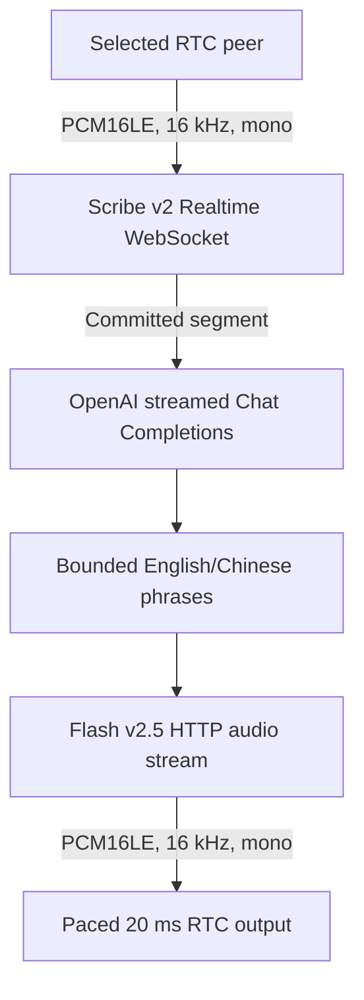

# Streaming voice agent

[简体中文](README.zh-CN.md) · [Examples](../README.md)

## Purpose

A standalone, server-side conversation demo for one Agora RTC channel and one selected human participant. It receives that participant's microphone audio, transcribes it with ElevenLabs Scribe v2 Realtime, streams an OpenAI answer, and publishes ElevenLabs Flash v2.5 speech back to the channel. No microphone or speaker is needed on the Go host.



This example is separate from `ai_audio`, which demonstrates SDK audio events. It adds no SDK API and no CLI flags.

## Configure and run

Install the native SDK using the repository's existing helper, from the repository root:

```sh
make download-agora-libs
```

Supply credentials through a private server-side environment or secret manager. Do not paste real keys or tokens into source files, committed shell scripts, chat, screenshots, or a browser/mobile client. The Go process needs the following variables:

| Variable | Meaning / default |
| --- | --- |
| `AGORA_APP_ID` | Required Agora project App ID |
| `AGORA_USER_ID` | Required bot identity; by default a nonzero numeric UID, such as `9001` |
| `AGORA_REMOTE_USER_ID` | Required selected human identity, such as `1001`; must differ from the bot |
| `AGORA_CHANNEL` | Channel shared with the client; default `go-sdk-example` |
| `AGORA_TOKEN` | Bot RTC token matching App ID, channel, identity mode and bot identity; omit only for a project that permits token-free access |
| `AGORA_IDENTITY_MODE` | `numeric` (default) or `string`; both participants must use the same identity namespace |
| `ELEVENLABS_API_KEY` | Required server-side key with access to Realtime STT and streaming TTS |
| `OPENAI_API_KEY` | Required server-side key with access to the selected model |
| `ELEVENLABS_VOICE_ID` | Default `JBFqnCBsd6RMkjVDRZzb`; choose a voice your ElevenLabs account can use |
| `VOICE_LANGUAGE` | Empty by default for automatic language selection; for example `zh` for Chinese. When set, passed to both ASR and TTS |
| `OPENAI_MODEL` | Default `gpt-4.1-mini`; use a model compatible with streamed Chat Completions |
| `VOICE_SYSTEM_PROMPT` | Optional override; the default requests a concise conversational answer in the user's language |

For the default numeric mode, use canonical decimal UIDs in `1..4294967295`. Obtain numeric-UID RTC tokens from your trusted token server using Agora's official token builder. The repository's `token.RTC` helper creates string-account tokens, not numeric-UID tokens. A digits-only string account is still a string identity; it does not become a numeric UID by having the same spelling.

After supplying the required credentials, set the non-secret demo identities and start the bot:

```sh
export AGORA_USER_ID=9001
export AGORA_REMOTE_USER_ID=1001
export AGORA_CHANNEL=go-sdk-example
# Optional for a Chinese test:
# export VOICE_LANGUAGE=zh
./scripts/with_agora_env.sh go run ./examples/voice_agent
```

The wrapper supplies the native library paths. Ctrl+C cancels work and closes the session. Running joins a real channel, sends participant audio/text to external providers, and can incur usage charges.

## Speak from an RTC client

1. Use a separate Agora audio-capable client on a phone or computer with microphone permission, preferably a headset. Configure the same App ID, channel and identity mode as the bot.
2. Join as the exact `AGORA_REMOTE_USER_ID` (`1001` in the example), with its own matching RTC token from your server. Do not reuse the bot UID or bot token. In numeric mode, join using the client's numeric-UID API; in string mode, use its string-account API.
3. Publish the client's microphone and subscribe to/play the bot's audio. The bot only processes the selected peer, so another participant will not drive the conversation. The bot's published reply can be heard by other subscribed channel participants; selection is not private delivery.
4. Wait for the bot's ASR-ready log before speaking. Audio received before readiness is ignored. Say a short question, pause, then listen to the response.
5. Speak again during playback to test interruption. Recognition remains active while the bot replies. Allow for network/transcription delay before the reply stops; audio already delivered remotely cannot be recalled.

There is no browser UI, client application, token server or local audio-device capture in this example. Use a dedicated test channel and keep provider API keys exclusively on the Go host. Use a headset to reduce acoustic echo: loudspeaker playback can enter the microphone and look like another user utterance.

## Streaming and turn boundaries

- Input is signed PCM16 little-endian, 16 kHz mono. The demo sends 100 ms / 3,200-byte ASR chunks and supplies paced zero-filled silence when RTC DTX provides no frames. This keeps the recognition timeline and silence-based commits moving without sending a burst of accumulated silence.
- Scribe v2 Realtime has approximately two seconds of initial buffering; startup and first-partial latency are not an immediate local-VAD signal. The demo chooses VAD commits with a 0.7-second silence threshold. A committed segment starts one demo turn; this is a silence boundary, not semantic end-of-turn detection.
- Partial transcripts replace the previous partial for their segment; they are not text deltas. Empty or repeated keepalive partials do not trigger additional turns or interruptions. The first nonempty partial of a new segment cancels the current generation once, including the LLM request, TTS request and queued reply audio, and calls `InterruptAudio` if reply audio has been sent.
- OpenAI text is read incrementally and split into bounded phrases, recognizing English and Chinese punctuation. Each phrase is a separate HTTP TTS request whose PCM response is consumed incrementally. TTS input is phrase-at-a-time, not bidirectional text streaming, and phrase boundaries can affect prosody.
- Reply PCM is paced in 20 ms frames rather than sent as fast as HTTP can download it. Interruption stops future work and queued output; it cannot undo packets already sent or sound already heard.
- Each request includes the system prompt and the current committed transcript only. There is no conversation history. Output is capped at 256 tokens. A token-limit finish, content-filter finish, refusal, empty completion or truncated stream is treated as an error and stops the demo rather than being accepted as a complete reply; some speech may already have played.

## Failures, privacy and limits

- Input queues are bounded. Queue overflow or detected SDK receive/event drops fail explicitly rather than silently corrupting a transcript. Provider failures, authentication errors, quota/rate limits and transport failures stop the demo with an error. It does not reconnect, replay audio, or retry a partially spoken turn. The selected peer leaving also ends the demo. Correct the cause and start a fresh session.
- Token renewal is not automated. Plan a short test and restart with fresh matching credentials before expiration; obtain the client's new token separately. Do not run this as an unattended production service.
- The selected participant's audio travels through Agora to this process and then to ElevenLabs STT. Committed transcripts and the configured prompt go to OpenAI. Generated reply text goes to ElevenLabs TTS; synthesized audio returns through Agora to subscribed participants.
- Transcript text is logged in the terminal. Treat the terminal, redirected logs and monitoring output as conversation data. API keys must never be logged. No local audio recording is required by this demo; that does not establish zero retention by providers. Check current provider retention/privacy settings and obtain informed participant consent before sending audio or text.
- Confirm current account/model/voice access, geographic availability, quotas and billing with Agora, ElevenLabs and OpenAI. A working key does not imply every model or voice is available. Continuous recognition, including silence, may affect billable usage; cancellation does not promise a refund for work already performed.
- Chinese recognition, the selected voice's Chinese pronunciation, phrase prosody, end-to-end latency and interruption behavior require listening tests with your account and client. Live provider credentials and real Agora interoperability have not been verified by the offline checks below.

## Offline checks

After native SDK installation, from the repository root:

```sh
./scripts/with_agora_env.sh go test ./examples/voice_agent
./scripts/with_agora_env.sh go test -race ./examples/voice_agent
mkdir -p bin
./scripts/with_agora_env.sh go build -o ./bin/voice_agent ./examples/voice_agent
```

The tests use local `httptest` HTTP/WebSocket servers and synthetic PCM; they do not require provider credentials, contact live providers or join an Agora channel. They exercise the demo's streaming contracts and failure/cancellation paths. Compilation and offline tests do not establish live audio quality or compatibility. Run an authorized, billable end-to-end test separately before relying on the demo.

## References

- [ElevenLabs Realtime speech-to-text API](https://elevenlabs.io/docs/api-reference/speech-to-text/v-1-speech-to-text-realtime)
- [Transcripts and commit strategies](https://elevenlabs.io/docs/eleven-api/guides/how-to/speech-to-text/realtime/transcripts-and-commit-strategies)
- [Realtime event reference](https://elevenlabs.io/docs/eleven-api/guides/how-to/speech-to-text/realtime/event-reference)
- [ElevenLabs streaming text-to-speech API](https://elevenlabs.io/docs/api-reference/text-to-speech/stream)
- [OpenAI streamed Chat Completions](https://developers.openai.com/api/reference/resources/chat/subresources/completions/methods/create)
- [Gorilla WebSocket v1.5.3 concurrency contract](https://github.com/gorilla/websocket/blob/v1.5.3/doc.go)
