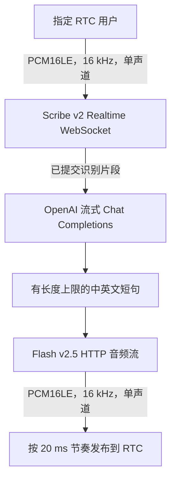

# 流式语音助手

[English](README.md) · [示例](../README.zh-CN.md)

## 用途

独立的服务端语音对话示例：在一个 Agora RTC 频道中接收一个指定真人用户的麦克风音频，通过 ElevenLabs Scribe v2 Realtime 识别语音，流式生成 OpenAI 回复，再将 ElevenLabs Flash v2.5 合成的语音发布回频道。运行 Go 程序的主机不需要麦克风或扬声器。



本示例独立于演示 SDK 音频事件的 `ai_audio`，不增加 SDK API，也没有新增命令行参数。

## 配置与运行

在仓库根目录使用现有脚本安装原生 SDK：

```sh
make download-agora-libs
```

通过私有服务端环境或密钥管理服务注入凭据。不要把真实密钥或 Token 粘贴到源码、提交到仓库的脚本、聊天、截图或浏览器/手机客户端中。Go 进程读取以下环境变量：

| 变量 | 含义 / 默认值 |
| --- | --- |
| `AGORA_APP_ID` | 必填，Agora 项目 App ID |
| `AGORA_USER_ID` | 必填，机器人身份；默认使用非零数值 UID，例如 `9001` |
| `AGORA_REMOTE_USER_ID` | 必填，指定真人用户的身份，例如 `1001`；必须与机器人不同 |
| `AGORA_CHANNEL` | 与客户端共用的频道，默认 `go-sdk-example` |
| `AGORA_TOKEN` | 与 App ID、频道、身份模式和机器人身份匹配的 RTC Token；仅允许无 Token 接入的项目可以省略 |
| `AGORA_IDENTITY_MODE` | `numeric`（默认）或 `string`；双方必须使用同一身份命名空间 |
| `ELEVENLABS_API_KEY` | 必填，具有实时 STT 和流式 TTS 权限的服务端密钥 |
| `OPENAI_API_KEY` | 必填，具有所选模型权限的服务端密钥 |
| `ELEVENLABS_VOICE_ID` | 默认 `JBFqnCBsd6RMkjVDRZzb`；选择当前 ElevenLabs 账号可用的音色 |
| `VOICE_LANGUAGE` | 默认留空，由服务自动选择语言；中文可设为 `zh`。设置后同时传给 ASR 与 TTS |
| `OPENAI_MODEL` | 默认 `gpt-4.1-mini`；需兼容流式 Chat Completions |
| `VOICE_SYSTEM_PROMPT` | 可选覆盖；默认要求使用用户的语言给出简短、适合对话的回答 |

默认数值模式要求 UID 是 `1..4294967295` 范围内的规范十进制字符串。请由可信 Token 服务使用 Agora 官方 Token Builder 签发数值 UID 的 RTC Token。仓库的 `token.RTC` 辅助函数生成的是字符串账号 Token，不能代替数值 UID Token。即使内容全是数字，字符串账号也不会自动变成同名的数值 UID。

注入必需凭据后，设置非敏感的测试身份并启动机器人：

```sh
export AGORA_USER_ID=9001
export AGORA_REMOTE_USER_ID=1001
export AGORA_CHANNEL=go-sdk-example
# 测试中文时可设置：
# export VOICE_LANGUAGE=zh
./scripts/with_agora_env.sh go run ./examples/voice_agent
```

环境脚本会配置原生库路径。Ctrl+C 取消处理并关闭会话。运行会加入真实频道，将参与者的音频/文本发送到外部服务，并可能产生费用。

## 从 RTC 客户端说话

1. 在另一台手机或电脑上准备支持 Agora 音频的客户端，授予麦克风权限，建议佩戴耳机。配置与机器人相同的 App ID、频道及身份模式。
2. 使用与 `AGORA_REMOTE_USER_ID` 完全相同的身份加入频道（上例为 `1001`），并使用服务端为该身份签发的独立 RTC Token。不要复用机器人的 UID 或 Token。数值模式使用客户端的数值 UID 入会接口；字符串模式使用字符串账号入会接口。
3. 发布客户端麦克风，并订阅、播放机器人的音频。机器人只处理指定用户，其他参与者不会驱动对话。频道内其他订阅者也可能听到机器人回复；指定输入用户并不等于私密发送回复。
4. 等待机器人终端显示 ASR 已就绪后再说话；就绪前收到的音频会被忽略。提出一个简短问题，停顿，然后收听回答。
5. 在回复播放期间再次说话以测试打断。机器人回复时识别仍在继续。停止播放需要网络和识别时间，已经传到远端的音频无法撤回。

本示例不包含浏览器界面、客户端应用、Token 服务或本地音频设备采集。使用专用测试频道，并将服务商 API 密钥仅保存在 Go 主机。耳机可减少声学回声：扬声器播放的回复可能被麦克风重新采集，误认为新的用户发言。

## 流式处理与轮次边界

- 输入为有符号 PCM16、小端、16 kHz、单声道。每次向 ASR 发送 100 ms / 3,200 字节；RTC DTX 无音频帧时，按节奏补充全零静音，保持识别时间线推进并触发基于静音的提交，不会集中突发发送积压静音。
- Scribe v2 Realtime 初始约有两秒缓冲；启动和首个 partial 的延迟不能等同于即时本地 VAD。示例采用 VAD 自动提交，静音阈值为 0.7 秒。每个已提交片段对应一个示例轮次；这是静音分段，不是语义上的轮次结束判断。
- Partial 文本替换该片段上一次的临时结果，不是增量文字。空文本或重复的保活 partial 不会触发额外回复或打断。新片段的第一个非空 partial 会取消当前回复一次，包括 LLM 请求、TTS 请求及排队音频，如已发送回复音频，还会调用 `InterruptAudio`。
- 增量读取 OpenAI 文本，按中英文标点等规则切成有长度上限的短句。每个短句发起独立的 HTTP TTS 请求，并增量读取 PCM 响应。TTS 输入是逐句提交，并非双向文本流；短句边界可能影响语调和连贯性。
- 回复 PCM 按 20 ms 帧定时发送，不随 HTTP 下载速度一次性灌入。打断会停止后续处理并清理排队输出，无法撤销已经发出的包或已经听到的声音。
- 每次请求仅包含系统提示词与当前已提交识别文本，不保留对话历史。输出上限为 256 tokens。达到长度上限、内容过滤、拒绝回答、空回复或流被截断均按错误处理并停止示例，不会将其当作完整回复；此时部分语音可能已经播放。

## 故障、隐私与限制

- 输入队列有容量上限。队列溢出或检测到 SDK 接收/事件丢失会明确失败，避免静默损坏识别内容。服务商故障、鉴权错误、配额/限流及传输错误会使示例报错退出；不会自动重连、重放音频或重试已经播放了一部分的回复。指定用户离开频道也会结束示例。排除原因后重新启动全新会话。
- 不自动续期 Token。安排短时测试，在过期前使用新凭据重启，并单独获取客户端的新 Token。不要把此示例作为无人值守的生产服务。
- 指定用户的音频经 Agora 到达本进程，再发送给 ElevenLabs STT；已提交识别文本和配置的提示词发送给 OpenAI；生成的回复文本发送给 ElevenLabs TTS，合成音频再经 Agora 传给订阅者。
- 识别文本会输出到终端。终端、重定向日志及监控输出都应按对话数据保护，绝不能记录 API 密钥。示例无需本地录音，但这不意味着服务商零留存。发送音频或文本前，确认服务商当前隐私/留存设置，并取得参与者的知情同意。
- 向 Agora、ElevenLabs 和 OpenAI 确认当前账号、模型、音色权限、地区可用性、配额及计费。密钥可用不代表所有模型或音色均可使用。持续识别及静音可能影响计费；取消请求不保证退还已处理内容的费用。
- 中文识别、所选音色的中文发音、短句衔接、端到端延迟及打断表现，需要用自己的账号和客户端试听。以下离线检查尚未验证真实服务商凭据或真实 Agora 互通。

## 离线检查

安装原生 SDK 后，在仓库根目录运行：

```sh
./scripts/with_agora_env.sh go test ./examples/voice_agent
./scripts/with_agora_env.sh go test -race ./examples/voice_agent
mkdir -p bin
./scripts/with_agora_env.sh go build -o ./bin/voice_agent ./examples/voice_agent
```

测试使用本地 `httptest` HTTP/WebSocket 服务和合成 PCM，不需要服务商凭据，不调用真实服务，也不加入 Agora 频道。测试覆盖示例的流式处理约定以及故障/取消路径。编译及离线测试通过不代表真实音质或兼容性已经验证；依赖本示例前，请另行开展经过授权、可能计费的端到端测试。

## 参考资料

- [ElevenLabs 实时语音识别 API](https://elevenlabs.io/docs/api-reference/speech-to-text/v-1-speech-to-text-realtime)
- [识别结果与提交策略](https://elevenlabs.io/docs/eleven-api/guides/how-to/speech-to-text/realtime/transcripts-and-commit-strategies)
- [实时事件参考](https://elevenlabs.io/docs/eleven-api/guides/how-to/speech-to-text/realtime/event-reference)
- [ElevenLabs 流式语音合成 API](https://elevenlabs.io/docs/api-reference/text-to-speech/stream)
- [OpenAI 流式 Chat Completions](https://developers.openai.com/api/reference/resources/chat/subresources/completions/methods/create)
- [Gorilla WebSocket v1.5.3 并发约定](https://github.com/gorilla/websocket/blob/v1.5.3/doc.go)
