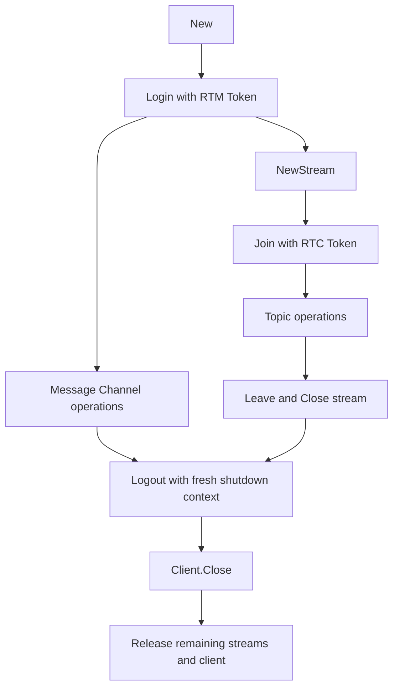

# Messaging (RTM) reference

[简体中文](README.zh-CN.md) · [Home](../README.md) · [Runnable scenarios](../examples/messaging/README.md)

`messaging` owns native RTM clients and Stream Channels. Its asynchronous methods correlate SDK result callbacks to requests; incoming events are copied into a bounded Go queue. It is independent of RTC `Service` and `Session`. Project feature access, quotas, and native errors still apply.

## Minimal example

Install the pinned SDK as described in the [root guide](../README.md). Run this program with `AGORA_APP_ID`, `AGORA_RTM_USER_ID`, and the matching `AGORA_RTM_TOKEN`. It subscribes, publishes one text message, and listens until Ctrl+C. Run another logged-in client with a different user ID in `demo` to test reception; do not rely on receiving your own publication.

```go
package main

import (
    "context"
    "errors"
    "fmt"
    "log"
    "os"
    "os/signal"
    "syscall"
    "time"

    "github.com/zyy17/agora-server-sdk/messaging"
)

func main() {
    ctx, stop := signal.NotifyContext(context.Background(), os.Interrupt, syscall.SIGTERM)
    defer stop()
    if err := run(ctx); err != nil {
        log.Print(err)
    }
}

func run(ctx context.Context) (err error) {
    client, err := messaging.New(messaging.Config{
        AppID:  os.Getenv("AGORA_APP_ID"),
        UserID: os.Getenv("AGORA_RTM_USER_ID"),
    })
    if err != nil {
        return err
    }
    defer func() { err = errors.Join(err, client.Close()) }()
    if err = client.Login(ctx, os.Getenv("AGORA_RTM_TOKEN")); err != nil {
        return err
    }
    defer func() {
        shutdown, cancel := context.WithTimeout(context.Background(), 3*time.Second)
        defer cancel()
        err = errors.Join(err, client.Logout(shutdown))
    }()
    if err = client.Subscribe(ctx, "demo", messaging.SubscribeOptions{}); err != nil {
        return err
    }
    if err = client.Publish(ctx, "demo", []byte("hello"), messaging.PublishOptions{Text: true}); err != nil {
        return err
    }
    for {
        event, nextErr := client.Next(ctx)
        if nextErr != nil {
            return nextErr
        }
        if event.Kind == messaging.EventMessage && event.Message != nil {
            fmt.Printf("%s: %s\n", event.Message.Publisher, event.Message.Data)
        }
    }
}
```

The loop filters message events because login and subscription also generate other event types. Production applications must also handle link/token events and monitor `DroppedEvents()`. Each asynchronous request has its own default 15-second deadline; the receive loop’s context remains active until canceled.

## Configuration and naming

| `Config` field | Wrapper default / validation |
| --- | --- |
| `AppID`, `UserID` | Required, valid UTF-8, no NUL; further format/length checks are native |
| `EventBuffer` | 128 events; zero selects default; accepted explicit range 1–65536 |
| `RequestTimeout` | 15 seconds; zero selects default; negative rejected |
| `Native` | `nil` uses the pinned binding’s `agorartm.NewRtmConfig()` defaults |

Use stable, distinct user IDs within one App ID. Official setup guidance limits RTM IDs to 64 ASCII characters; logging in elsewhere with the same ID can displace the existing login. For compatible names, prefer ASCII letters/digits/underscores/hyphens, beginning with a letter or digit; check current service restrictions before using other characters. Wrapper UTF-8 validation alone does not enforce the native naming rules.

If supplying `Config.Native`, start from `agorartm.NewRtmConfig()` and adjust only needed fields. The wrapper overwrites `AppId`, `UserId`, `UseStringUserId`, and `EventHandler`. Region, logging, proxy, encryption, and private settings follow the pinned native configuration, not defaults from another language/version. Do not mutate `Native` or its referenced values while `New` runs.

## Lifecycle, concurrency, and cancellation



- `New` allocates a client; it does not log in. Call `Login` before service operations. Creation is not proof of network or feature access.
- `Client` and `Stream` methods support concurrent callers. Native initiation is serialized; request waits are independent and keyed by request ID, including callbacks received before initiation returns. Do not mutate caller-owned input maps/slices while an operation is reading them.
- Each asynchronous wait uses the earlier of the caller deadline and `RequestTimeout`. Nil contexts are invalid. Cancellation stops waiting, **not an already submitted operation**, and cannot interrupt a synchronous native call already running.
- A canceled publish, metadata write, or lock acquisition may still take effect. Inspect remote state or use an application idempotency scheme before retrying. The wrapper disables automatic native lock-acquisition retry.
- `Close` is idempotent and unblocks pending requests with `ErrClosed`. `Client.Close` releases remaining streams before the client, then no further operations may be initiated. `Stream.Close` also fails its pending requests.
- `Close` does not await `Logout` or a graceful stream `Leave`. When required, call those first with a fresh bounded context, then close even if they fail. A blocked native call can delay close.

## Channels and publication options

| API | Destination and prerequisite |
| --- | --- |
| `Publish` | Message Channel; publisher must log in but need not subscribe |
| `Subscribe` / `Unsubscribe` | Message Channel reception; `Subscribe` always enables message events |
| `PublishToUser` | Direct message to a logged-in user ID; no channel subscription required |
| `NewStream` / `Stream.Join` | Owned Stream Channel; log in, create, then join before topic operations |
| `Channel{Name, Type}` | Presence, metadata, locks: `MessageChannel` or `StreamChannel`; history: `MessageChannel` or `UserChannel` |

| Option | Zero value / behavior |
| --- | --- |
| `PublishOptions.Text` | `false`: binary; `true`: valid UTF-8 required; a text payload may contain NUL |
| `PublishOptions.CustomType` | Empty; otherwise UTF-8 without NUL |
| `PublishOptions.StoreInHistory` | `false`; opt in at publish time and enable project history access |
| `SubscribeOptions.Presence` / `Metadata` / `Locks` | All `false`; opt in to each event family and provision required project features |
| `SubscribeOptions.Quiet` | `false`; `true` requests native quiet subscription behavior |

The wrapper’s `SubscribeOptions{}` differs from native defaults: messages are enabled, Presence/Metadata/Locks are disabled. Publish payloads must be nonempty. Server message-size and rate quotas are not prechecked; inspect native errors. A nil publish error means the SDK operation succeeded, not that a recipient application processed or persisted the message. Add application acknowledgments when that distinction matters.

## Presence

| API / option | Contract |
| --- | --- |
| `OnlineUsers(ctx, channel, PresenceOptions)` | One page; user IDs always included; `IncludeState` defaults to `false` |
| `PresenceOptions.Page` | Empty for first page; pass returned `NextPage` unchanged; empty `NextPage` ends paging |
| `UserChannels(ctx, userID)` | Queries channels for a user |
| `SetState(ctx, channel, map)` | Nonempty map; nonempty keys; keys/values must be UTF-8 without NUL |
| `State(ctx, channel, userID)` | Queries a user’s channel state |
| `RemoveState(ctx, channel, keys...)` | Removes specified keys; **an empty key list removes all state keys** |

State is channel-scoped Presence data, not durable application storage. Querying online users does not require joining the channel; receiving Presence events requires subscribing or joining with Presence enabled. `SetState` only sets the current user’s state. Project permissions remain native requirements. Paginated results and queued events are not an atomic snapshot across a changing channel.

## Metadata and revision checks

Use `SetChannelMetadata`, `UpdateChannelMetadata`, `RemoveChannelMetadata`, and `ChannelMetadata` for channel items; corresponding `*UserMetadata` methods address user items. `Set` creates or replaces supplied items, `Update` modifies existing items, and `Remove` deletes supplied keys; native errors define missing-item/revision conflicts. User metadata events require `SubscribeUserMetadata`; channel metadata events require the subscription/join `Metadata` option.

For unconditional writes, explicitly set **both** `Metadata.Revision` and each `MetadataItem.Revision` to `-1`. Go zero values are forwarded unchanged; they are not converted to `-1`. For conditional writes, use revisions returned by a query and handle conflicts. Do not confuse whole-set revision with per-item revision.

This is a value-construction example; pass it to the appropriate metadata method with a valid channel/user and context:

```go
metadata := messaging.Metadata{
    Revision: -1,
    Items: []messaging.MetadataItem{
        {Key: "status", Value: "ready", Revision: -1},
    },
}
```

The wrapper requires at least one item, unique nonempty keys, and valid UTF-8 without NUL in keys, values, and author IDs. `MetadataOptions.RecordTimestamp` / `RecordUserID` default to `false`. `LockName` optionally protects channel metadata writes and is rejected for user metadata writes. Storage feature access, item limits, and lock ownership are checked by the service.

## Locks

The lifecycle is `SetLock` → `AcquireLock` → `ReleaseLock` → `RemoveLock`; `Locks` queries definitions/owners, and `RevokeLock` targets a specified owner. `SetLock` defines a lock but does not acquire it. TTL describes how long ownership is retained after its owner disconnects/leaves, not the lifetime of the lock definition. The official range is 10–300 seconds; the wrapper only checks positive whole seconds fitting `uint32`, so server validation can still reject a locally valid duration.

Enable lock feature access and `Locks` events where needed. A request timeout does not prove acquisition failed; query before retrying. Lock events may be dropped locally, so do not use this queue alone as proof of continued ownership for a consequential write.

## History

`History(ctx, channel, options)` queries **Message Channel or User Channel** history; Stream Channels are unsupported. User Channel history addresses a user channel; do not treat it as a bidirectional conversation log. History must be enabled, and the message must have been published with `StoreInHistory: true`; ordinary pub/sub examples do not create stored history.

| Field | Contract |
| --- | --- |
| `HistoryOptions.Count` | Zero selects 100; explicit range 1–100 |
| `Start` | Exclusive newer bound / cursor; zero delegates to native default |
| `End` | Inclusive older bound; zero delegates to native default |
| Nonzero bounds | `Start >= End`; results are queried from newer to older |
| `HistoryPage.NextStart` | Zero ends paging; otherwise pass as the next `Start`, retaining other query options |
| `HistoryMessage.Data` | Copied binary-safe payload; timestamps retain native units |

Do not convert history cursors to RTC media timestamps or assume a wall-clock unit from the field name. Preserve SDK-returned cursors. The official API also limits an explicit query interval to 24 hours; the wrapper leaves that check to the service because it preserves native timestamp units. Service retention, availability, and rate limits still apply; an event queue is not a replacement for history storage.

## Stream Channels and Topics

A Stream is owned by its Client; its events arrive on the Client queue. Call `NewStream`, `Join`, then topic operations. `JoinOptions.Token` is an **RTC Token for that Stream Channel**, separate from the RTM login token. `Presence`, `Metadata`, `Locks`, and `Quiet` default to `false`; enable only the needed event families.

| API / option | Contract |
| --- | --- |
| `JoinTopic` / `LeaveTopic` | Join/leave as a publisher; reception separately uses `SubscribeTopic` |
| `TopicOptions.Ordered` | `false`; `true` requests native ordered QoS |
| `TopicOptions.Metadata` | Empty; UTF-8 without NUL |
| `TopicOptions.SyncWithMedia` | `false`; native media synchronization behavior when enabled |
| `TopicOptions.Priority` | `PriorityNormal`; alternatives: `PriorityHighest`, `PriorityHigh`, `PriorityLow` |
| `Stream.Publish` | Nonempty payload; `TopicMessageOptions.Text` defaults to binary, `CustomType` empty, `SendTimestamp` zero; timestamp semantics are native |
| `SubscribeTopic(topic, users...)` | Subscribes to specified publishers; inspect `Succeeded` / `Failed` even when an error is returned |
| `UnsubscribeTopic` | Removes publisher subscriptions |
| `Subscribers(topic)` | Returns publisher IDs this client subscribes to; not the audience subscribing to this client |
| `Leave` / `Close` | Leave the native channel, then release it; Client close releases any remaining streams |

Ordering, priority, and media synchronization do not replace application delivery acknowledgments. Use explicit publisher IDs and inspect partial subscription results. The [stream scenario](../examples/messaging/README.md) demonstrates setup and teardown; it is not a long-running topic receiver.

## Authentication and renewal

| Operation | Token |
| --- | --- |
| `Client.Login`, `Client.RenewToken` | RTM Token for the configured App ID and RTM user ID |
| `Stream.Join`, `Stream.RenewToken` | RTC Token for the Stream Channel and identity |
| Root `token.RTC` helper | RTC AccessToken2 only; not RTM token generation |

Obtain tokens from a trusted application server. Empty tokens are accepted by the wrapper but may be rejected by project authentication settings. Consume `EventTokenExpiring` / `EventToken`, inspect their channel/type information, and renew the matching client or stream; there is no automatic token service. Keep known expiry times and link state under application control because event overflow can drop token notifications. Never embed App Certificates in end-user applications.

## Events and queue behavior

`Events()` returns a buffered receive-only channel; `Next(ctx)` consumes the same queue. Event kinds are `EventMessage`, `EventPresence`, `EventTopic`, `EventLock`, `EventStorage`, `EventLink`, `EventToken`, and `EventTokenExpiring`. Read only the populated field indicated by `Kind`. Data, nested slices/maps, and binary payloads are independent Go copies and can outlive the callback/client.

A full RTM queue drops the **newest** event and increments `DroppedEvents()`. This includes token and state events. Request results use a separate correlation path and are not dropped by event-queue overflow. A live context drains buffered events after close; once empty, `Next` returns `ErrClosed`, and ranging `Events()` ends. Canceled contexts return their context error. Multiple consumers compete for events; fan out explicitly if needed. This differs from [RTC’s oldest-drop / `io.EOF` contract](../docs/rtc.md#queues-and-data-lifetime).

## Native access and errors

`WithNative(ctx, fn)` serializes native access. The callback must return promptly and must not reenter the Client or its Streams, retain/release borrowed objects, or replace event handlers. Asynchronous result callbacks belong to the wrapper; use public context-aware methods for supported requests. `SetParameters` accepts a JSON object and uses this serialized path.

| Error | Meaning |
| --- | --- |
| `ErrInvalidArgument` | Wrapper validation failed |
| `ErrClosed` | Client/stream closed, pending request canceled by close, or event queue drained |
| `ErrUnavailable` | Requested native interface could not be obtained |
| `context.Canceled` / `context.DeadlineExceeded` | Waiting ended; submitted side effects may still occur |
| `*messaging.Error` | Immediate or asynchronous SDK rejection; inspect `Op`, `Code`, and `Details` |

Use `errors.Is` for sentinels/context errors and `errors.As` for `*messaging.Error`. `ErrorCode` preserves the native numeric value. Native methods with void submission signatures still await their result callback; submission alone is not reported as success. For partial topic subscription, inspect the returned publisher lists alongside the error.

## Sources and verification scope

Wrapper contracts come from [`client.go`](client.go), [`types.go`](types.go), and feature-specific files in this package. The native distribution pin is an RTC/Go release identifier, not an RTM core version; call `messaging.Version()` to inspect the loaded RTM core. The pinned Linux core reports 2.3.0.1, while the Chinese C++ reference is labeled 2.3.0. Online additions are not automatically available in this distribution.

Official Chinese sources:

- [Application setup and identities](https://doc.shengwang.cn/doc/rtm2/cpp/user-guide/setup/application-setup) and [migration/naming guidance](https://doc.shengwang.cn/doc/rtm2/cpp/overview/migration-guide)
- [Message publication](https://doc.shengwang.cn/doc/rtm2/cpp/user-guide/message/send-message), [Channel API](https://doc.shengwang.cn/api-ref/rtm2/cpp/toc-channel/channel), and [Token API](https://doc.shengwang.cn/api-ref/rtm2/cpp/toc-token/token)
- [Storage and revisions](https://doc.shengwang.cn/api-ref/rtm2/cpp/toc-storage/storage) and [Lock semantics](https://doc.shengwang.cn/api-ref/rtm2/cpp/toc-lock/lock)
- [History guide](https://doc.shengwang.cn/doc/rtm2/cpp/user-guide/message/history-message) and [Message/History API](https://doc.shengwang.cn/api-ref/rtm2/cpp/toc-message/message)

Offline tests cover request correlation, cancellation, timeouts, close races, queue overflow, copied multi-element results, callback lifetimes, and binary payloads. They do not establish live delivery, feature entitlement, regional availability, or quotas. Validate those with dedicated project resources. This client package does not include cloud REST services, RTM token issuance, or legacy RTM service APIs.
