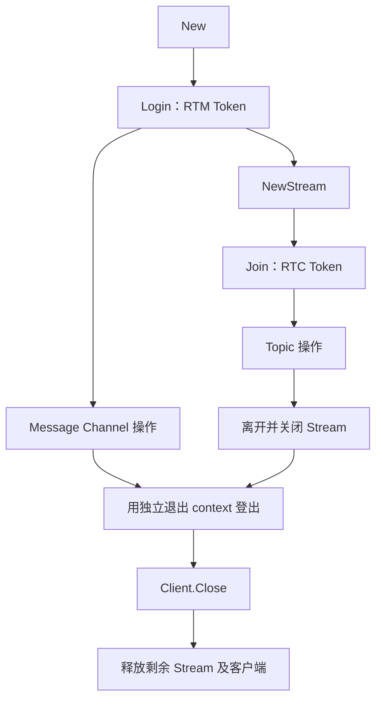

# RTM 使用指南

[English](README.md) · [首页](../README.zh-CN.md) · [可运行示例](../examples/messaging/README.zh-CN.md)

`messaging` 管理原生 RTM 客户端及 Stream Channel。异步方法按请求关联 SDK 结果回调，接收事件复制后进入有界 Go 队列。它独立于 RTC `Service` 和 `Session`，仍受项目功能权限、配额及原生错误约束。

## 最小示例

按[首页说明](../README.zh-CN.md)安装固定 SDK。运行程序时设置 `AGORA_APP_ID`、`AGORA_RTM_USER_ID` 及匹配的 `AGORA_RTM_TOKEN`。程序订阅频道、发布一条文本消息，持续接收到 Ctrl+C。测试接收时，在 `demo` 中运行另一个已登录且 ID 不同的客户端，不要依赖自身消息回送。

```go
package main

import (
    "context"
    "errors"
    "fmt"
    "log"
    "os"
    "os/signal"
    "syscall"
    "time"

    "github.com/zyy17/agora-server-sdk/messaging"
)

func main() {
    ctx, stop := signal.NotifyContext(context.Background(), os.Interrupt, syscall.SIGTERM)
    defer stop()
    if err := run(ctx); err != nil {
        log.Print(err)
    }
}

func run(ctx context.Context) (err error) {
    client, err := messaging.New(messaging.Config{
        AppID:  os.Getenv("AGORA_APP_ID"),
        UserID: os.Getenv("AGORA_RTM_USER_ID"),
    })
    if err != nil {
        return err
    }
    defer func() { err = errors.Join(err, client.Close()) }()
    if err = client.Login(ctx, os.Getenv("AGORA_RTM_TOKEN")); err != nil {
        return err
    }
    defer func() {
        shutdown, cancel := context.WithTimeout(context.Background(), 3*time.Second)
        defer cancel()
        err = errors.Join(err, client.Logout(shutdown))
    }()
    if err = client.Subscribe(ctx, "demo", messaging.SubscribeOptions{}); err != nil {
        return err
    }
    if err = client.Publish(ctx, "demo", []byte("hello"), messaging.PublishOptions{Text: true}); err != nil {
        return err
    }
    for {
        event, nextErr := client.Next(ctx)
        if nextErr != nil {
            return nextErr
        }
        if event.Kind == messaging.EventMessage && event.Message != nil {
            fmt.Printf("%s: %s\n", event.Message.Publisher, event.Message.Data)
        }
    }
}
```

登录和订阅也会产生其他事件，因此循环按消息类型筛选。生产应用还应处理连接和 Token 事件，并监控 `DroppedEvents()`。每个异步请求各有默认 15 秒超时；接收循环的 context 在取消前持续有效。

## 配置与命名

| `Config` 字段 | 封装默认值与校验 |
| --- | --- |
| `AppID`、`UserID` | 必填，有效 UTF-8，不含 NUL；其他格式和长度限制由原生层检查 |
| `EventBuffer` | 128 项；零值使用默认值；显式范围为 1–65536 |
| `RequestTimeout` | 15 秒；零值使用默认值，负值无效 |
| `Identity` | 默认未设置 `Native` 时使用字符串 ID；设置后保留 `Native.UseStringUserId`；可显式指定 `IdentityString` / `IdentityNumeric` |
| `Connection` | 可选的类型化区域、传输协议、Presence/心跳/重连计时、Multipath 和 ISP 配置 |
| `Log`、`Proxy`、`Encryption`、`Private` | 非 nil 时覆盖 `Native` 中对应配置 |
| `Parameters` | 创建时应用的 JSON 对象；空值保留 `Native.Parameters` |
| `ResultEvents` | 默认为 `false`；开启后接收所有异步结果，包括超时后的迟到回调 |
| `Native` | nil 使用固定 Go 绑定默认值；保留兼容配置及平台 `Context` |

同一 App ID 下使用稳定且不重复的用户 ID。官方接入说明将 RTM ID 限制为 64 个 ASCII 字符；其他端使用同一 ID 登录可能挤掉原连接。为提高兼容性，名称优先使用 ASCII 字母、数字、下划线和连字符，并以字母或数字开头；使用其他字符前先核对服务限制。封装的 UTF-8 校验不能替代原生命名规则。

优先使用 `ConnectionConfig`、`LogConfig`、`ProxyConfig`、`EncryptionConfig` 和 `PrivateConfig`，无需导入底层绑定即可配置原生选项。连接计时必须为非负整秒且能放入 `uint32`；显式传入 `ConnectionConfig` 时零时长原样传递，零区域代表全球。零重连时长表示原生无限重试，与 Go 请求超时独立。nil 连接配置保留固定 Go 绑定的 Presence/心跳/重连默认值 30/0/0 秒。`EncryptionConfig.Salt` 为固定 32 字节数组；创建时会复制引用数据。`New` 读取期间不要并发修改输入。

`IdentityNumeric` 按 RTC 兼容的数值身份解释 `UserID`，须传十进制字符串并使用一致的 Token 身份。`IdentityString` 可将看似数字的 ID 保留为字符串身份。若使用 `Config.Native`，先以 `agorartm.NewRtmConfig()` 初始化。封装仅固定覆盖 `AppId`、`UserId` 和 `EventHandler`，显式类型化配置优先。与旧版本不同，`IdentityDefault` 现在保留 `Native.UseStringUserId`；如需以前强制字符串的行为，请明确设置 `IdentityString`。区域、代理、加密及私有服务仍受原生功能支持限制。平台 `Context` 通过 `Native` 设置，须遵守 cgo 指针生命周期规则。

## 生命周期、并发与取消



- `New` 只创建客户端，不登录。服务操作前调用 `Login`。创建成功不代表网络或功能权限可用。
- `Client` 和 `Stream` 方法支持并发调用。原生请求发起过程串行执行，各请求独立等待，按请求 ID 关联结果；提前到达的回调也能关联。操作读取输入 map 或 slice 期间，不要修改它们。
- 每个异步等待受调用方截止时间和 `RequestTimeout` 中较早者约束。nil context 无效。取消只停止等待，**不会撤销已提交的操作**，也无法中断正在执行的同步原生调用。
- 已取消等待的消息、元数据写入或获取锁操作仍可能生效。重试前检查远端状态，或在业务层实现幂等。`AcquireLock` 禁用原生重试；`AcquireLockWithOptions` 可启用重试，且重试可能持续到调用方 context 结束之后。
- `Close` 可重复调用，未完成请求以 `ErrClosed` 结束。`Client.Close` 先释放剩余 Stream，再释放客户端；关闭后不能再发起操作。`Stream.Close` 也会终止该 Stream 的未完成请求。
- `Close` 不等待 `Logout` 或 Stream 正常 `Leave`。需要时先用独立、有超时的 context 调用它们；即使失败也应继续关闭。阻塞的原生调用可能延迟关闭。

## 频道与发布选项

| API | 目标与前提 |
| --- | --- |
| `Publish` | Message Channel；发送者须登录，无需先订阅 |
| `Subscribe` / `Unsubscribe` | Message Channel 接收；消息默认开启，`DisableMessages` 可关闭 |
| `PublishToUser` | 向已登录的用户 ID 发送私信；无需频道订阅 |
| `NewStream` / `Stream.Join` | 受管理的 Stream Channel；先登录、创建、加入，再操作 Topic |
| `Channel{Name, Type}` | Presence、元数据、锁使用 `MessageChannel` 或 `StreamChannel`；历史使用 `MessageChannel` 或 `UserChannel` |

| 选项 | 零值与行为 |
| --- | --- |
| `PublishOptions.Text` | `false` 为二进制；`true` 要求有效 UTF-8；文本载荷可含 NUL |
| `PublishOptions.CustomType` | 默认空值；非空时须为不含 NUL 的 UTF-8 |
| `PublishOptions.StoreInHistory` | `false`；发布时显式开启，并开通项目历史功能 |
| `SubscribeOptions.Presence` / `Metadata` / `Locks` | 均为 `false`；按需开启事件并开通相应项目功能 |
| `SubscribeOptions.DisableMessages` | 默认 `false`；设为 `true` 可只订阅 Presence/元数据/锁 |
| `SubscribeOptions.Quiet` | `false`；`true` 请求原生静默订阅行为 |

封装的 `SubscribeOptions{}` 与原生默认值不同：开启消息，关闭 Presence、Metadata 和 Locks。发布载荷不能为空。封装不预检服务端消息大小和频率配额，应处理原生错误。发布返回 nil 表示 SDK 操作成功，不代表接收应用已处理或持久化消息；需要时增加业务回执。

## 在线状态

| API 或选项 | 约定 |
| --- | --- |
| `OnlineUsers(ctx, channel, PresenceOptions)` | 每次一页，默认包含用户 ID，`ExcludeUserID` 可关闭；`IncludeState` 默认为 `false` |
| `PresenceOptions.ExcludeUserID` | 默认为 `false`；`true` 原样传递 `includeUserId=false`。固定 C 回调没有总人数，因此这不是人数统计 API |
| `PresenceOptions.Page` | 首次为空；原样传入返回的 `NextPage`；`NextPage` 为空表示结束 |
| `UserChannels(ctx, userID)` | 查询用户所在频道 |
| `SetState(ctx, channel, map)` | map 非空，键非空；键和值均须为不含 NUL 的 UTF-8 |
| `State(ctx, channel, userID)` | 查询用户在频道内的状态 |
| `RemoveState(ctx, channel, keys...)` | 删除指定键；**不传键会删除全部状态键** |

State 是频道范围的在线状态，不是持久业务存储。查询在线用户无需先加入频道；接收 Presence 事件则需订阅或加入频道并开启 Presence。`SetState` 仅设置当前用户的状态。项目权限仍由原生服务检查。频道持续变化时，多页查询和队列事件不构成原子快照。

## 元数据与版本检查

频道元数据使用 `SetChannelMetadata`、`UpdateChannelMetadata`、`RemoveChannelMetadata` 和 `ChannelMetadata`；对应 `*UserMetadata` 方法操作用户元数据。`Set` 创建或替换传入项，`Update` 修改已有项，`Remove` 删除指定键；缺失项和版本冲突由原生层报错。用户元数据事件需调用 `SubscribeUserMetadata`；频道元数据事件需开启订阅或加入选项中的 `Metadata`。

无条件写入时，显式将 `Metadata.Revision` **及每个** `MetadataItem.Revision` 设为 `-1`。Go 零值会原样传入，不会转为 `-1`。条件写入应使用查询返回的版本并处理冲突；整体版本和单项版本不能混用。

以下仅构造数据；调用对应元数据方法时，还需提供有效频道或用户及 context：

```go
metadata := messaging.Metadata{
    Revision: -1,
    Items: []messaging.MetadataItem{
        {Key: "status", Value: "ready", Revision: -1},
    },
}
```

封装要求至少一项、键非空且不重复，键、值和作者 ID 均须为不含 NUL 的 UTF-8。`MetadataOptions.RecordTimestamp` / `RecordUserID` 默认为 `false`。`LockName` 可保护频道元数据写入，用户元数据写入不接受该选项。存储权限、条目限制及锁归属由服务检查。

## 锁

调用顺序为 `SetLock` → `AcquireLock` → `ReleaseLock` → `RemoveLock`；`Locks` 查询锁和持有者，`RevokeLock` 针对指定持有者撤销锁。`SetLock` 只创建锁，不获取锁。TTL 表示持有者断开或离开后保留锁归属的时间，不是锁定义的存活时长。官方范围为 10–300 秒；封装仅检查能以 `uint32` 表示的正整数秒，因此通过本地校验仍可能被服务拒绝。

需开通锁功能，并按需开启 `Locks` 事件。`AcquireLock(ctx, channel, name)` 保留不重试的便捷行为；`AcquireLockWithOptions(ctx, channel, name, AcquireLockOptions{Retry: true})` 可开启原生重试。

**取消或超时只结束 Go 等待，不会取消原生重试。** 固定 SDK 没有按请求取消的 API，Go 方法返回后（包括先收到获取失败回调后）仍可能取得锁，单次失败不能证明重试已停止。创建前开启 `Config.ResultEvents`，处理 `RequestAcquireLock` 结果及锁事件；如取得的锁已不再需要，用全新的 context 调用 `ReleaseLock`。参见[参与编译的清理示例](example_test.go)，示例接管专用客户端并在每条退出路径关闭它以停止后续重试，假设同一目标只有一次获取请求且仅一个事件消费者；并发同目标操作时应自行分发和关联。

单次 `Locks` 查询只是快照，不能证明进行中的重试之后不会成功。发生事件丢弃时要重新核对，并在重试客户端整个生命周期内持续处理所有权及清理。关闭只释放原生资源，不等同于成功 `ReleaseLock`；断开后所有权仍受原生 TTL 约束。不能只凭事件队列确认重要写入时仍持有锁。

## 历史消息

`History(ctx, channel, options)` 查询 **Message Channel 或 User Channel** 历史，不支持 Stream Channel。User Channel 历史按用户频道查询，不能视为双向会话记录。项目需开通历史功能，且消息发布时设置了 `StoreInHistory: true`；普通 pub/sub 示例不会写入历史。

| 字段 | 约定 |
| --- | --- |
| `HistoryOptions.Count` | 零值选择 100；显式范围为 1–100 |
| `Start` | 较新边界或游标，不含边界；零值使用原生默认值 |
| `End` | 较旧边界，包含边界；零值使用原生默认值 |
| 非零边界 | `Start >= End`；从新到旧查询 |
| `HistoryPage.NextStart` | 零值表示结束；否则作为下一页的 `Start`，其他查询选项保持不变 |
| `HistoryMessage.Data` | 支持二进制的独立副本；时间戳保持原生单位 |

不要把历史游标转换为 RTC 媒体时间戳，也不要凭字段名推断墙钟单位；应保留 SDK 返回的游标。官方 API 还将显式查询区间限制为 24 小时；封装保留原生时间戳单位，由服务校验该范围。历史保留期限、可用性和调用频率仍受服务约束；事件队列不能替代历史存储。

## Stream Channel 与 Topic

Stream 由 Client 管理，事件进入 Client 队列。先调用 `NewStream`、`Join`，再操作 Topic。`JoinOptions.Token` 是**该 Stream Channel 的 RTC Token**，不同于 RTM 登录 Token。`Presence`、`Metadata`、`Locks` 和 `Quiet` 均默认为 `false`，只开启需要的事件。

| API 或选项 | 约定 |
| --- | --- |
| `JoinTopic` / `LeaveTopic` | 以发布者身份加入或离开；接收需另行调用 `SubscribeTopic` |
| `TopicOptions.Ordered` | `false`；`true` 请求原生有序 QoS |
| `TopicOptions.Metadata` | 默认空值；须为不含 NUL 的 UTF-8 |
| `TopicOptions.SyncWithMedia` | `false`；开启后采用原生媒体同步行为 |
| `TopicOptions.Priority` | `PriorityNormal`；可选 `PriorityHighest`、`PriorityHigh`、`PriorityLow` |
| `Stream.Publish` | 载荷非空；`TopicMessageOptions.Text` 默认二进制，`CustomType` 为空，`SendTimestamp` 为零；时间戳语义由原生层定义 |
| `SubscribeTopic(topic, users...)` | 订阅指定发布者；即使返回错误，也应检查 `Succeeded` / `Failed` |
| `UnsubscribeTopic` | 取消发布者订阅 |
| `Subscribers(topic)` | 返回本客户端订阅的发布者 ID，不是订阅本客户端的观众列表 |
| `Leave` / `Close` | 离开原生频道，再释放对象；Client 关闭时释放剩余 Stream |

有序、优先级和媒体同步不能替代业务送达回执。应显式指定发布者 ID，并检查部分订阅结果。[Stream 示例](../examples/messaging/README.zh-CN.md)演示创建和清理流程，不是持续接收 Topic 的程序。

## 鉴权与续期

| 操作 | Token |
| --- | --- |
| `Client.Login`、`Client.RenewToken` | 匹配 App ID 和 RTM 用户 ID 的 RTM Token |
| `Stream.Join`、`Stream.RenewToken` | 匹配 Stream Channel 和身份的 RTC Token |
| 根目录 `token.RTC` 辅助函数 | 仅生成 RTC AccessToken2，不生成 RTM Token |

Token 由可信业务服务端签发。封装接受空 Token，但项目鉴权设置可能拒绝。处理 `EventTokenExpiring` / `EventToken` 时，应检查频道及类型，更新对应 Client 或 Stream；封装不提供自动 Token 服务。事件溢出可能丢失续期通知，业务还应管理已知有效期并监控连接状态。不要在终端应用中嵌入 App Certificate。

## 事件与队列行为

`Events()` 返回有缓冲的只读通道；`Next(ctx)` 消费同一队列。事件类型为 `EventMessage`、`EventPresence`、`EventTopic`、`EventLock`、`EventStorage`、`EventLink`、`EventToken` 和 `EventTokenExpiring`；开启 `ResultEvents` 后还包含 `EventRequestResult`。按 `Kind` 读取对应字段。数据、嵌套 slice/map 和二进制载荷均为独立 Go 副本，可在回调或客户端结束后继续使用。

RTM 队列满时丢弃**最新**事件，并增加 `DroppedEvents()`，Token 和状态事件也不例外。请求结果走独立关联路径，不受事件队列溢出影响。context 有效时，关闭后仍可排空缓冲；排空后 `Next` 返回 `ErrClosed`，遍历 `Events()` 则结束。取消的 context 返回对应错误。多个消费者竞争事件，需要广播时自行分发。这与 [RTC 丢弃最旧项、返回 `io.EOF` 的规则](../docs/rtc.zh-CN.md#队列与数据生命周期)不同。

### 类型化请求结果与迟到完成

`Config.ResultEvents: true` 将 38 个原生异步结果回调分别复制到 `Event.RequestResult`。`Operation` 使用具名 `RequestOperation` 常量，`RequestID` 保留 SDK 关联 ID。`Channel`、`UserID`、`Topic`、`TopicMetadata`、`LockName` 和 `Service` 保留相应回调提供的上下文。查询使用类型化字段 `Presence`、`State`、`Channels`、`Metadata`、`Locks`、`Subscription`、`Subscribers` 和 `History`；错误回调也保留错误码、详情及部分数据。

事件数据与同步方法返回的 slice/map 相互独立。超时、取消或原生重复回调之后仍可观察结果。等待中的方法采用第一个匹配回调，重复回调不会覆盖首个结果。结果事件共享有界队列，可能被丢弃；方法本身的完成关联不经过该队列。本地校验、提交失败及 context 错误不会伪造原生回调，客户端关闭后不再接收新回调。

`PresenceEventType`、`TopicEventType`、`LockEventType`、`StorageEventType`、`TokenEventType`、`LinkState`、`LinkOperation`、`LinkReason`、`ServiceType`、`StorageType` 均提供具名常量，无需使用魔法数字；保留原生数值及未来未知值。`ErrorCode` 提供固定版本带符号的 `Code…` 常量，`Reason()` 返回已加载 SDK 对该错误的说明。

## 原生访问与错误

`WithNative(ctx, fn)` 串行访问原生接口。回调应及时返回，不得再次调用该 Client 或其 Stream 方法，不得保留或释放借用对象，也不得替换事件处理器。异步结果回调由封装管理；已有高层方法的请求应使用支持 context 的接口。`SetParameters` 接受 JSON 对象，并通过同一串行路径执行。

| 错误 | 含义 |
| --- | --- |
| `ErrInvalidArgument` | 封装校验失败 |
| `ErrClosed` | Client/Stream 已关闭、请求因关闭结束，或事件队列已排空 |
| `ErrUnavailable` | 无法取得所需原生接口 |
| `context.Canceled` / `context.DeadlineExceeded` | 等待结束；已提交的操作仍可能生效 |
| `*messaging.Error` | 同步或异步 SDK 拒绝；读取 `Op`、`Code` 和 `Details` |

用 `errors.Is` 判断哨兵和 context 错误，用 `errors.As` 读取 `*messaging.Error`。`ErrorCode` 保留原生数值。提交签名无返回值的原生方法仍等待结果回调，不会仅凭提交就报告成功。Topic 部分订阅失败时，同时检查发布者列表和错误。

## 固定版本覆盖与原生边界

依据是[官方 Go SDK v2.6.5 的 `d51ff1b5…` 提交](https://github.com/AgoraIO-Extensions/Agora-Golang-Server-SDK/tree/d51ff1b5baf85dd53155b31543bceba8ec304dc7/go_sdk/rtm)、仓库中的 C 头文件及匹配动态库，而非其他语言的新版本 SDK。

| 固定接口 | 高层 API |
| --- | --- |
| 客户端创建/释放、登录/登出、续期、发布、订阅、参数、版本/错误说明 | `New` / `Close`、`Login` / `Logout`、`RenewToken`、`Publish` / `PublishToUser`、`Subscribe` / `Unsubscribe`、`SetParameters`、`Version`、`ErrorCode.Reason` |
| Presence 用户/频道查询，状态设置/删除/查询 | `OnlineUsers`、`UserChannels`、`SetState`、`RemoveState`、`State`；底层保留语义对应的旧版 `WhoNow` / `WhereNow` |
| 元数据构造，频道/用户增改删查，用户元数据订阅 | `Metadata` 值及对应 `*ChannelMetadata` / `*UserMetadata` 方法 |
| 锁定义、查询、删除、获取、释放、撤销 | `SetLock`、`Locks`、`RemoveLock`、`AcquireLock` / `AcquireLockWithOptions`、`ReleaseLock`、`RevokeLock` |
| 历史查询 | `History` 及类型化消息和游标 |
| Stream 创建/名称/加入/离开/释放，续期及 Topic 全部操作 | `NewStream`、`Name`、`Join`、`Leave`、`Close`、`RenewToken`、`JoinTopic`、`LeaveTopic`、`Publish`、`SubscribeTopic`、`UnsubscribeTopic`、`Subscribers` |
| 8 个主动事件回调及 38 个结果回调 | 8 类普通事件及可选 `EventRequestResult`；完整复制载荷 |

固定 C ABI 的真实限制：

- 官方 Go 源码中的旧 `OnConnectionStateChanged` 在固定 `C_IRtmEventHandler` 中没有字段。连接通知使用 `OnLinkStateEvent` / `EventLink`，不恢复不兼容回调布局。
- C++ `IStreamChannel::setParameters` 没有固定 C 包装/导出，也不是官方 Go 方法；客户端 `SetParameters` 仍可用。
- C++ 消息/Presence/Topic/锁/存储事件的时间戳及 interval 的 `totalOccupancy` 未包含在固定 C 回调结构中，无法可靠重建，不提供伪造的零值字段。ABI 实际携带的 Link/Token/History 时间戳完整保留。
- 无法按请求取消或取消原生重试；Go 取消只结束等待。

底层包保留官方全部 143 个公开函数/方法名。请求 ID/错误返回值与完整 slice 回调的安全修正继续保留，不以恢复不安全签名冒充兼容。`GetAuthorUserId` 提供正确拼写，同时保留上游 `GetAquthorUserId` 别名。

## 资料与验证范围

封装约定以 [`client.go`](client.go)、[`types.go`](types.go) 及本包对应功能实现为准。原生分发包版本是 RTC/Go 发布标识，不等于 RTM 核心版本；通过 `messaging.Version()` 查询实际核心。固定 Linux 核心报告 2.3.0.1，中文 C++ 文档标注 2.3.0；在线文档新增功能不代表当前分发包已支持。

中文官方资料：

- [应用接入与身份](https://doc.shengwang.cn/doc/rtm2/cpp/user-guide/setup/application-setup)、[迁移与命名要求](https://doc.shengwang.cn/doc/rtm2/cpp/overview/migration-guide)
- [发布消息](https://doc.shengwang.cn/doc/rtm2/cpp/user-guide/message/send-message)、[频道 API](https://doc.shengwang.cn/api-ref/rtm2/cpp/toc-channel/channel)、[Token API](https://doc.shengwang.cn/api-ref/rtm2/cpp/toc-token/token)
- [存储与版本](https://doc.shengwang.cn/api-ref/rtm2/cpp/toc-storage/storage)、[锁语义](https://doc.shengwang.cn/api-ref/rtm2/cpp/toc-lock/lock)
- [历史消息指南](https://doc.shengwang.cn/doc/rtm2/cpp/user-guide/message/history-message)、[消息与历史 API](https://doc.shengwang.cn/api-ref/rtm2/cpp/toc-message/message)

离线测试覆盖请求关联、取消、超时、关闭竞态、队列溢出、多元素结果复制、回调生命周期和二进制载荷；不验证真实送达、功能权限、区域可用性或配额。应使用专用项目资源联调。本客户端包不含云端 REST 服务、RTM Token 签发或旧版 RTM 服务 API。
